# vps-server

**简体中文** | [English](doc/en/README.md) | [Español](doc/es/README.md)

在一个 Web 控制台中管理 VPS 测速, 代理, FRP 和 Tailscale, 减少重复的终端操作.

[](LICENSE) [](https://github.com/CharlesGool/vps-server/releases/tag/v6.1.0)

## 文档

- 项目概览: [README](README.md)

- 设计思路: [DESIGN](doc/DESIGN.md)

- 项目状态: [LOG](doc/LOG.md)
- 历史记录: [HISTORY](doc/HISTORY.md)
- 变更日志: [CHANGELOG](doc/CHANGELOG.md)

- 第三方声明: [THIRD_PARTY_NOTICES](doc/THIRD_PARTY_NOTICES.md)

## 简介

- 浏览器上传/下载测速, 访客记录, 限时 iperf3 服务端与客户端测试.
- Singbox 托管 AnyTLS, VMess, VLESS, Trojan 和 Shadowsocks 节点, 支持分享, 配额, 限速与到期策略.
- FRPS 服务端(与 Singbox 节点相同的流量统计, 配额, 限速与到期策略, 按 bindPort 计量), FRPC 实例及 TCP/UDP 代理管理, Tailscale 状态与设备管理.
- 域名转发: 按子域名把 HTTPS 转发到本机端口(例如 frps 端口)或控制台本身, 随附 Caddy 自动申请 Let's Encrypt 证书, 用 Cloudflare API 自动维护 DNS 记录(仅 DNS, 每 5 分钟检查本机公网 IP); 可添加多个 Cloudflare 令牌(例如域名在不同账号), 每个站点自动使用能管理它主域名的令牌. 每个站点可启停, 编辑, 绑定多个域名, 限制来源 IP 或设访问密码, 后端可为 HTTPS; 提供访问日志, 变更记录和 Bark 通知(IP 变化, DNS 失败, 证书将过期). 开启后 Caddy 占用 80/443, 公开可达性页面改由 Caddy 提供(见下).
- IP 证书: 首页单独的开关, 为本机公网 IPv4 申请 Let's Encrypt 证书, 控制台原来的 `https://IP:端口` 改用它, 浏览器不再提示证书不安全. 不需要域名或 Cloudflare 令牌, 只需 80 端口能从公网访问; 与域名转发共用随附的 Caddy(需安装域名转发模块), 两者任一开启时 Caddy 运行并占用 80/443. 这时首页的公开页面开关照常可用, 页面由 Caddy 直接返回: 80 端口对 IP 和任何未配置的名字都显示它(不跳转 HTTPS, 以便检测 80 本身是否可达), 443 端口只在开着 IP 证书时对 `https://本机IP/` 显示.
- 模块按需安装, 端口转发, 带免密下载链接的小网盘, 详细日志, 密码保护的浏览器 root 终端, 三语言与主题设置.
- 登录失败逐次加长封禁, 控制台访问地址限制, 登录设备管理, 安全记录和 Bark 登录提醒.
- 默认只安装 Web, 公开可达性页面默认关闭. 首页的"公开页面"卡片用一个开关同时开关 HTTP 和 HTTPS 两个页面. 已知问题与验证边界见 [LOG](doc/LOG.md#缺陷).

### 界面预览

以下为 v5.3.0 发布前测试构建在测试环境的实拍, 使用简体中文界面. 展示已安装模块, 创建表单和 Tailscale 未登录状态;默认安装仍仅包含 Web. 地址与凭据保持隐藏, 日志截图只展示分类和筛选控件.

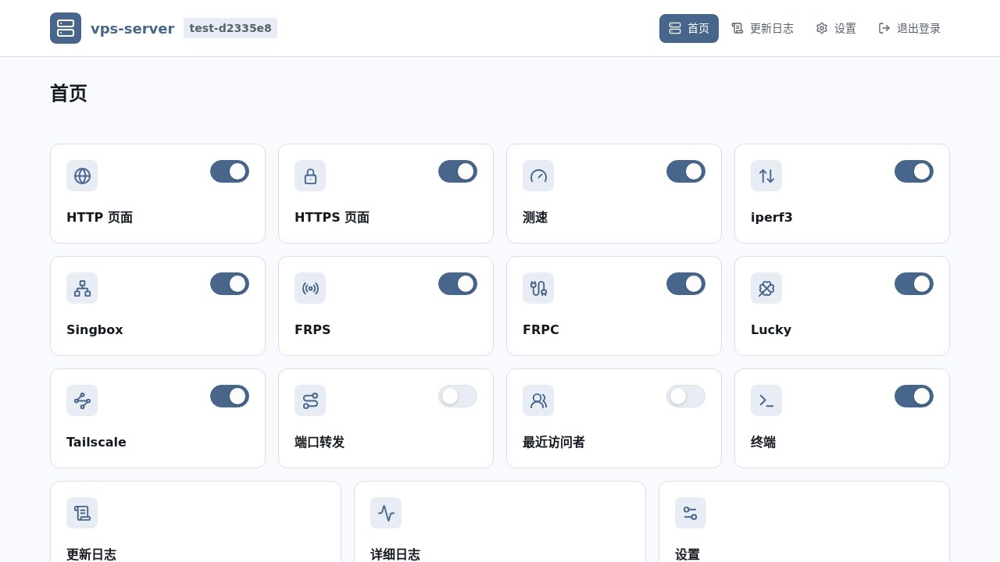

<details>
<summary>登录与测速</summary>

**登录**

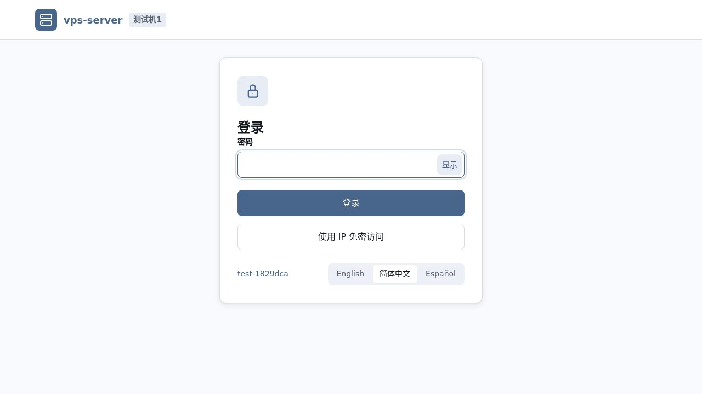

**iperf3 服务端与客户端**

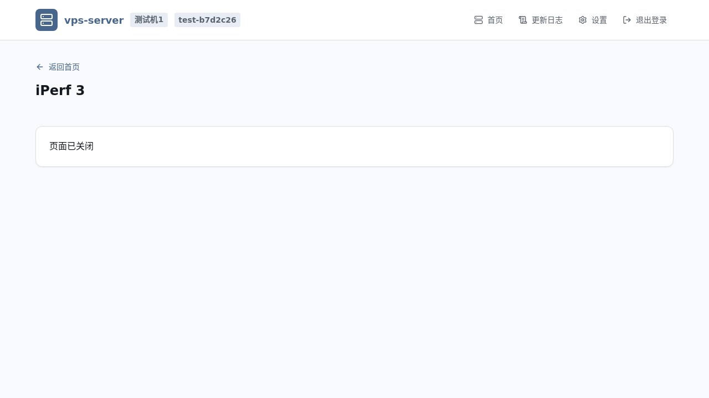

</details>

<details>
<summary>Singbox 与 FRP</summary>

**Singbox 节点概览**

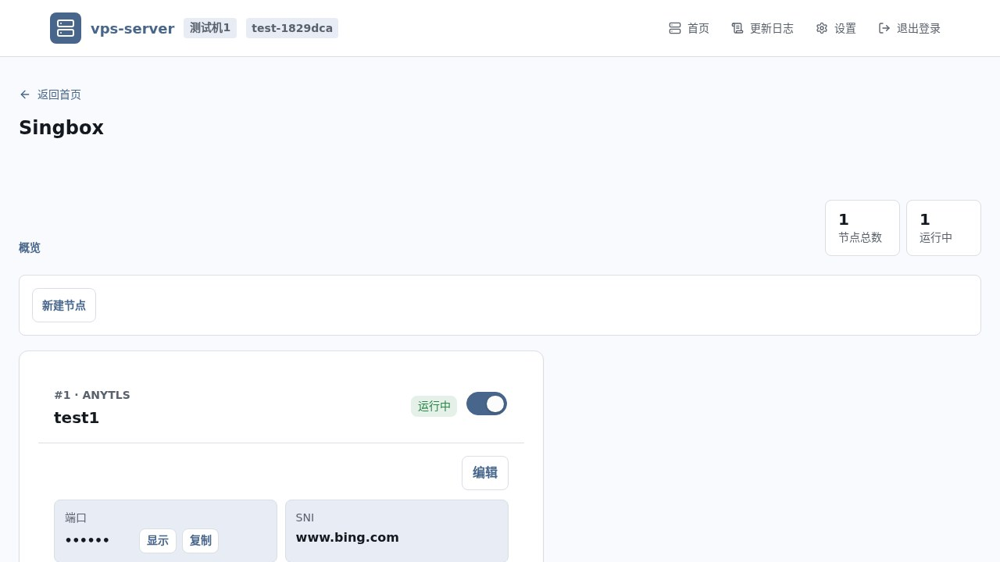

**创建 Singbox 节点**

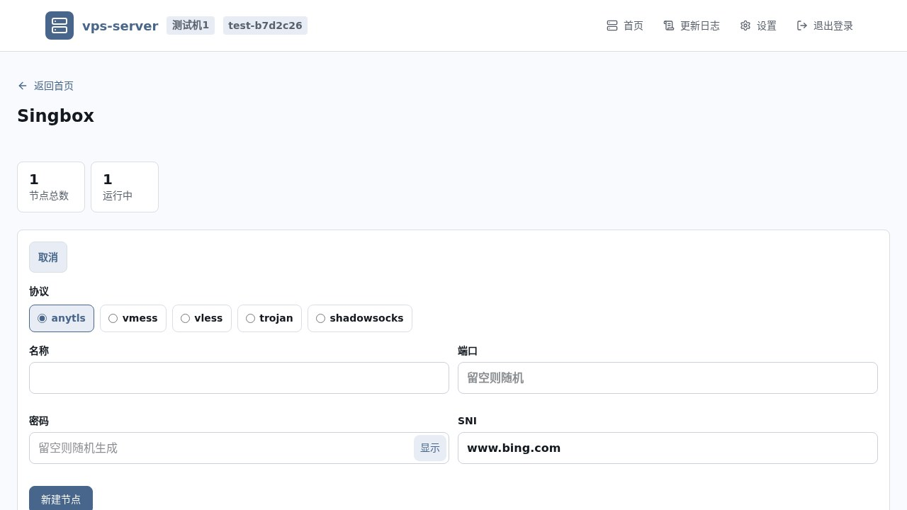

**Singbox 访问管理**

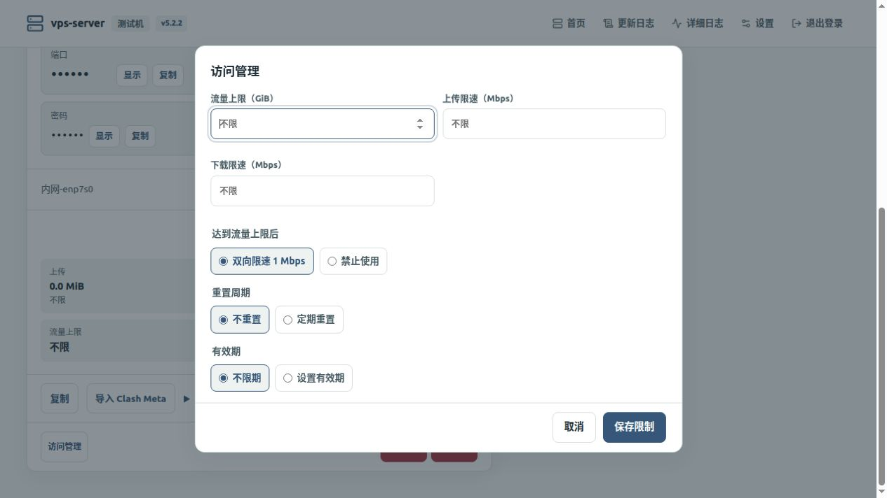

**FRPS 服务端**

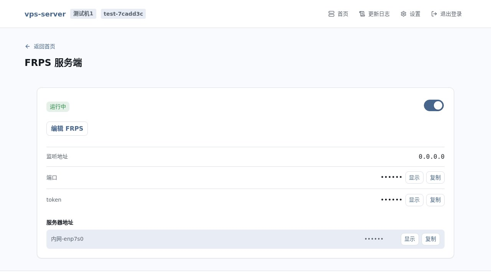

**创建 FRPC 实例**

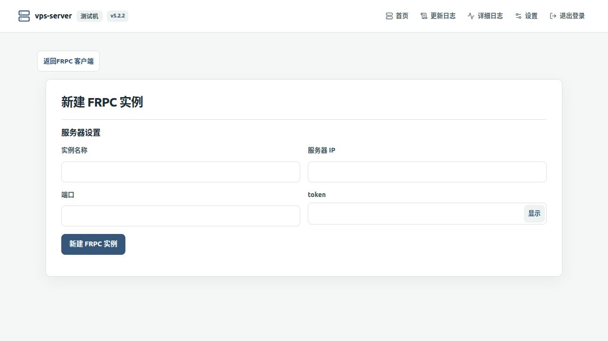

</details>

<details>
<summary>Tailscale</summary>

**Tailscale 概览与连接表单**

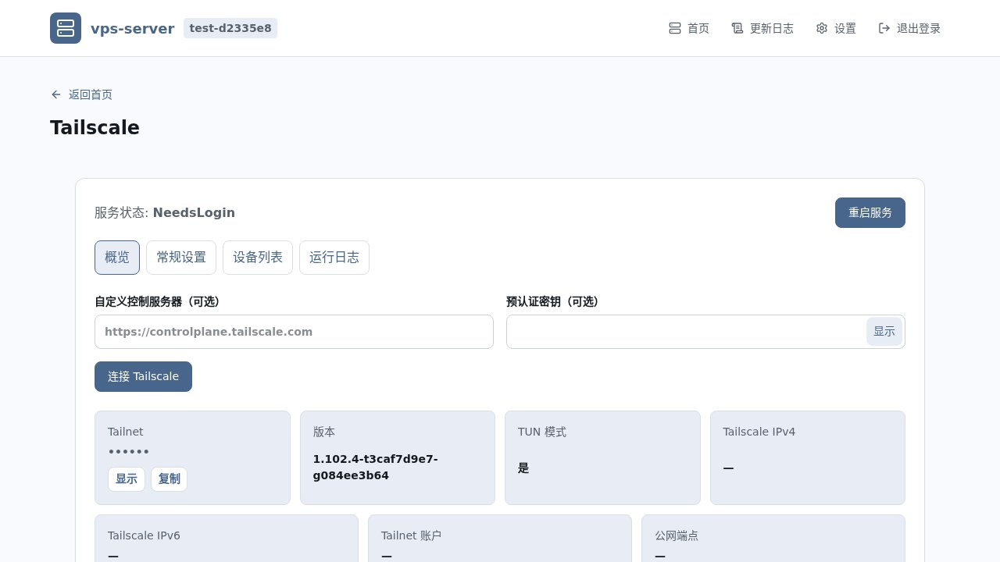

**Tailscale 常规设置**

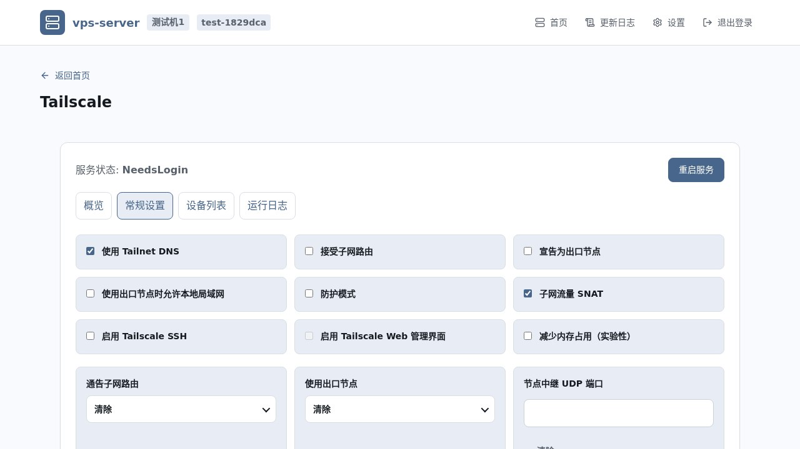

**Tailscale 日志筛选**

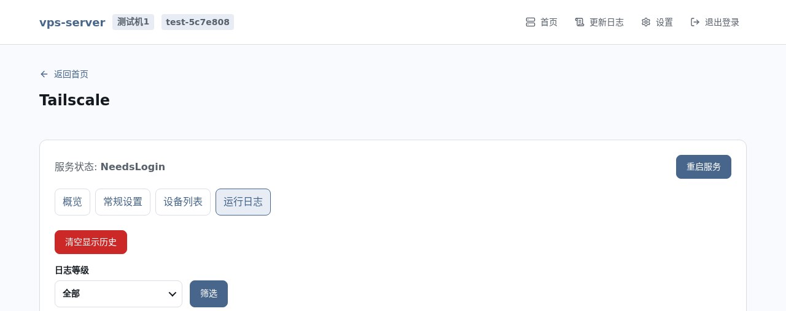

</details>

<details>
<summary>设置与日志</summary>

**主题与语言设置**

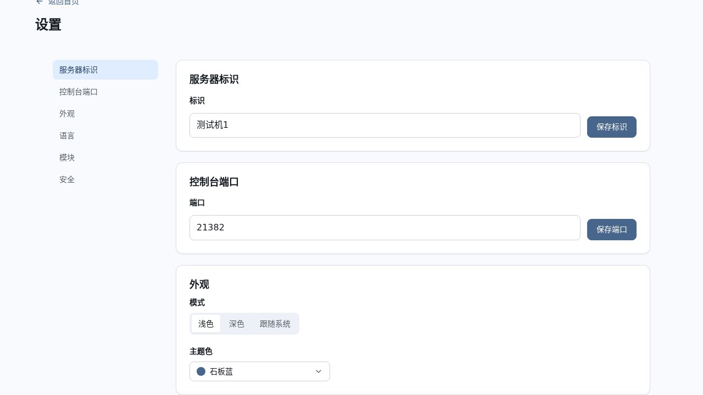

**模块管理**

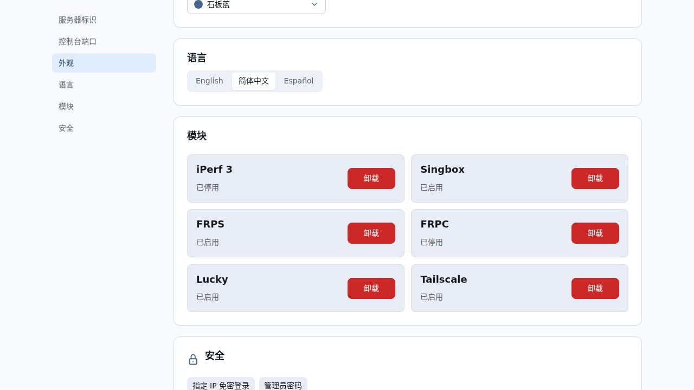

**管理员密码验证**

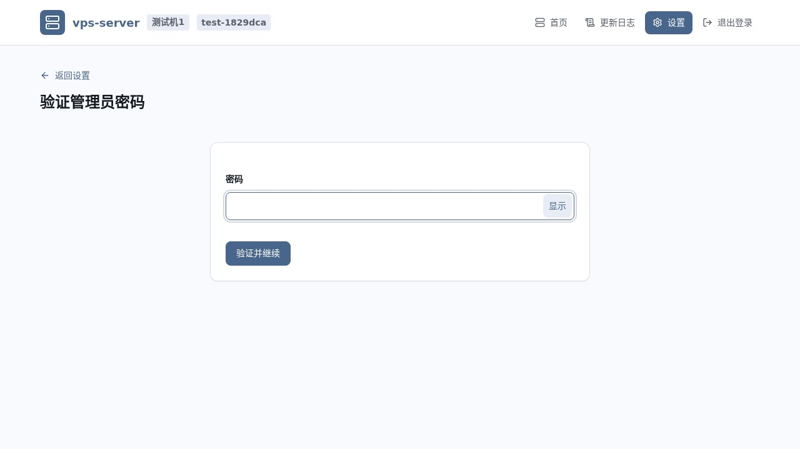

**详细日志分类与筛选**

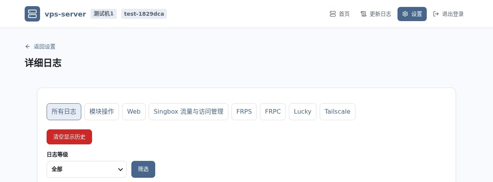

**更新日志**

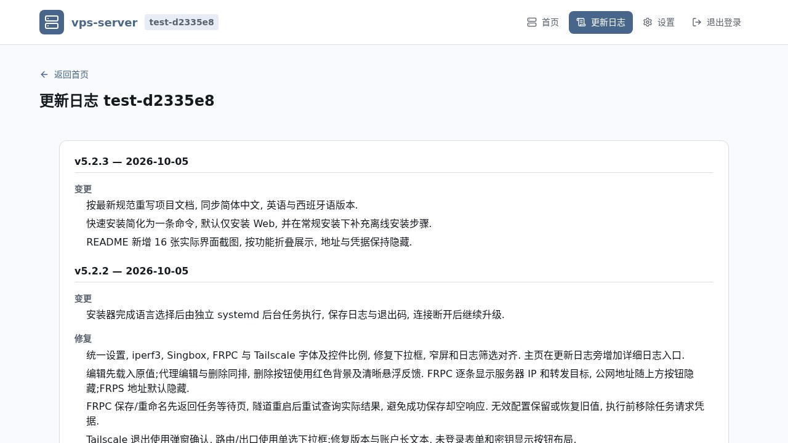

</details>

## 要求

最低要求: x86-64 Linux, systemd, root 权限, Python 3.9+, Bash 及可写的安装/状态目录. 安装器面向 Debian 11+ 与 Ubuntu 20.04+;其他架构不支持. 端口转发需要 iptables, Singbox 节点和 FRPS 的流量统计和限速需要 nft;系统没有可用的版本时, 使用完整安装包随附的 Debian 13 nft/iptables, 它们自带加载器和 glibc, 断网也能用. 修改控制台端口和检测目标端口是否在监听需要 `ss`, 安装摘要和 Tailscale 路由显示需要 `ip`(均属 iproute2). 系统组件的最低版本: Bash 4.1, systemd 240, Python 使用的 SQLite 3.24 和 OpenSSL 库 1.1.1, `/usr/bin/python3` 与 PATH 中的 `python3` 都须为 3.9+;还需要 flock, sha256sum, base64, getent, install, mktemp, systemd-run. 在线版还需要 CA 证书(ca-certificates). 主机的 `ip`/`ss` 不支持 JSON 路由或 `-H` 时改用随附的版本. 主机 iperf3 只在没有随附版本时使用, 且须为 3.1+. 安装器在改动任何服务前检查这些条件: 上述最低版本不满足或 Python 低于 3.9 时停止安装, 缺少 iptables(且没有随附运行库), `ss` 或 `ip` 只警告, nft 不可用或系统已有 Tailscale 守护进程时停止安装.

推荐使用维护中的 Debian/Ubuntu, 保留备份空间并开放选用功能的端口. Debian 13 x86-64 已实机验证;Python 3.9 和其他发行版未独立验收. Release 提供两个安装包: 离线版内置全部第三方程序, 目标机只需 Python 3.9+, 不需要 curl, Git, tar 或 gzip, 也不联网; 在线版体积小, 安装时联网下载这些程序并校验 SHA-256, 缺少的 iptables, iproute2, nftables 由安装器用 apt 安装. 离线版还内置 iptables, nftables 和 iproute2(`ss`, `ip`), 主机缺少时自动改用内置的. 源码构建离线包需要联网.

## 安装

以 root 执行.

### 快速安装

一条命令只安装 Web 页面, 其他模块在设置/模块中按需添加. 下面是离线版; 在线版把文件名换成 `vps-server-v6.1.0-linux-amd64-online.tar.gz`, 也可以直接用这条命令:

```bash
python3 -c 'import sys, tarfile, urllib.request; t = tarfile.open(fileobj=urllib.request.urlopen(sys.argv[1]), mode="r|gz"); t.extraction_filter = getattr(tarfile, "tar_filter", None); t.extractall("/root")' https://github.com/CharlesGool/vps-server/releases/download/v6.1.0/vps-server-v6.1.0-linux-amd64.tar.gz && VPSSRV_MODULES=web bash /root/vps-server/deploy/install.sh
```

### 常规安装

源码安装需先在 `web/` 构建前端(Node.js 24). 仓库不含 sing-box, frp, Caddy 和 Tailscale 等上游程序, 安装时像在线版一样联网下载并校验 SHA-256;私有 nftables 运行库只在完整离线包中提供. `cp` 步骤可省略;需要定制时先编辑 `.env`.

```bash
git clone --depth 1 --branch v6.1.0 https://github.com/CharlesGool/vps-server.git /root/vps-server-source
cd /root/vps-server-source
(cd web && npm ci && npm run check)
cp .env.example .env
bash deploy/install.sh
```

#### 在线版

只需目标机能联网. 安装包约 4 MB, 其余程序在安装时按所选模块下载.

```bash
python3 -c 'import sys, tarfile, urllib.request; t = tarfile.open(fileobj=urllib.request.urlopen(sys.argv[1]), mode="r|gz"); t.extraction_filter = getattr(tarfile, "tar_filter", None); t.extractall("/root")' https://github.com/CharlesGool/vps-server/releases/download/v6.1.0/vps-server-v6.1.0-linux-amd64-online.tar.gz && VPSSRV_MODULES=web bash /root/vps-server/deploy/install.sh
```

#### 离线安装

在联网机器下载 [完整安装包](https://github.com/CharlesGool/vps-server/releases/download/v6.1.0/vps-server-v6.1.0-linux-amd64.tar.gz)和 [SHA256SUMS](https://github.com/CharlesGool/vps-server/releases/download/v6.1.0/SHA256SUMS), 传到目标机的 `/root/vps-server-download/`, 然后执行. 目标机只需 Python 3.9+, 不需要联网, curl, Git, tar 或 gzip.

```bash
cd /root/vps-server-download
sha256sum -c --ignore-missing SHA256SUMS
python3 -c 'import sys, tarfile; t = tarfile.open(sys.argv[1]); t.extraction_filter = getattr(tarfile, "tar_filter", None); t.extractall("/root")' vps-server-v6.1.0-linux-amd64.tar.gz
VPSSRV_MODULES=web bash /root/vps-server/deploy/install.sh
```

安装开始时的语言选择在 5 秒内没有回答就用默认值继续(`VPSSRV_PROMPT_TIMEOUT` 可改秒数, `0` 表示一直等待), 因此无人值守也能装完. 完成语言选择后, 安装交给 systemd 后台任务执行, 当前终端只显示关键步骤, 完成后给出控制台地址和初始密码;失败时给出原因和几行相关日志. 按 Ctrl-C 或终端断开只停止显示, 安装继续. 源码目录在任务完成前**必须**保留. 停止显示后, 默认路径下查看完整日志和结果:

```bash
tail -f /root/apps/vps-server/.local/install-job/install.log
cat /root/apps/vps-server/.local/install-job/exit-code
```

`exit-code` 不存在表示未完成, `0` 表示成功, 其他值表示失败. 自定义 `PREFIX` 时替换日志路径. 每个模块在改动前检查主机条件(如 Singbox 需要可用的 nftables, Tailscale 需要 `/dev/net/tun`), 不满足时直接说明原因和处理办法;控制台的未安装模块也会提前显示. 主机没有能读取规则的 nftables 时, 安装器和控制台的 Singbox 安装任务都会先用 apt 自动安装 `nftables`, 不需要再到终端执行命令;没有 apt 或安装失败时才停止并说明原因.

## 指南

安装结束后用日志给出的地址和密码登录. 在设置/模块中安装所需组件, 然后管理节点, FRPC 实例或限时测速. 地址和凭据默认隐藏;编辑表单加载原值. 浏览器 root 终端和安全设置需要再次验证管理员密码. 控制台只提供 HTTPS. Tailscale 未登录时先连接并完成认证, 子网路由仍需 Tailnet 管理端批准.

### 客户端证书登录

可以用客户端证书(公钥/私钥)代替密码登录. 在 设置 > 安全 > 客户端证书 中为每台设备生成证书, 下载 `.p12` 文件并记下只显示一次的导入密码, 导入系统或浏览器后完全重启浏览器. 再打开控制台时浏览器会询问用哪个证书, 登录页出现"使用证书登录". 证书名称带主机名, 便于在选择框里区分. 签发后的页面第一步提供 Windows, macOS 和 Linux 的一键设置文件: 导入证书, 并让浏览器自动选中它, 手动导入 `.p12` 的步骤收在"手动导入"里; 已导入证书的设备在证书卡片的"免去每次手动选证书"下载不带证书的版本, 只开启自动选择. 每台设备各用一张证书, 新设备在本页另外生成. Windows 双击 `.cmd`(无需管理员权限, 支持 Chrome 和 Edge); macOS 双击 `.mobileconfig` 后在 系统设置 > 隐私与安全性 > 描述文件 中安装(Chrome 和 Edge); Linux 在终端运行 `bash` 加 `.sh` 文件(写入策略时会用 sudo, 支持 Chrome, Chromium 和 Edge, 导入证书需要 libnss3-tools). 服务器只保存证书序列号, 不保存设备私钥;丢失或不用的证书在同一页撤销.

确认当前连接已使用证书后, 开启"要求客户端证书": 没有有效证书的设备连登录页都打不开, 密码不能再用于登录, 只用于打开 root 终端和安全设置时的二次验证. 指定 IP 免密登录同样需要证书, Clash 订阅链接不受影响. 证书由安装包随附的静态 OpenSSL 3.5 LTS 签发, 使用项目自带的最小配置, 不受主机 openssl 版本和 openssl.cnf 影响. 每个证书颁发机构先在主机 TLS 库上做一次双向 TLS 自检; 旧版主机 openssl 生成的无效颁发机构会被换掉, 由它签发的证书标为已撤销, 并关闭"要求客户端证书". `client_cert.py check` 显示所用的 openssl 和自检结果.

证书丢失而被挡在外面时, 在服务器上以 root 关闭证书要求, 恢复密码登录(不需要重启服务, 自定义 `PREFIX` 时替换路径):

```bash
python3 /root/apps/vps-server/src/web/client_cert.py disable
```

`status` 参数列出要求状态和所有证书.

### 网盘

首页的"网盘"默认关闭, 打开后可以在这台服务器上临时存放文件, 再生成免密码的下载链接, 例如让访问不了 GitHub 的服务器从这里下载. 文件有两种来源: 从浏览器上传, 或填一个 http/https 链接让服务器自己下载(在后台进行, 可关闭浏览器). 容量上限默认 5 GiB, 可在页面上修改; 无论上限多少, 磁盘始终至少留 500 MiB 空闲. 每个文件可生成多个下载链接, 每个链接可选有效期(5, 10, 30 分钟, 1, 2, 5 小时, 1, 7, 30 天或永久)和最多下载次数, 随时可作废. 链接形如 `https://<控制台地址>/f/<令牌>/<文件名>`, 拿到链接的人不需要密码或客户端证书, `curl -O`, `wget` 和断点续传都可用; 只有从头开始的请求计入下载次数. 关闭网盘后链接全部失效, 文件保留.

### 登录安全

以下设置都在 设置 > 安全.

- **登录失败封禁**: 同一 IP 在窗口内输错密码达到次数后被暂时封禁, IPv6 按 /64 网段合并计数. 一天内再次触发时封禁时长每次乘 10(默认 30 秒, 5 分钟, 50 分钟, 约 8 小时, 最长 24 小时). 封禁期间正确密码也无法登录, 成功登录会清除该 IP 的计数. 所有来源合计失败过多时, 暂停从未成功登录过的地址用密码登录(默认 60 秒内 20 次, 暂停 5 分钟), 已登录过的地址, 证书登录和 IP 免密登录不受影响. 开关默认开启; 关闭后仍记录每个 IP 的失败次数, 达到阈值只标记不封禁, 用于测试检测是否生效. 切换开关会清除当前的封禁和标记; 记录保存在内存中, Web 重启后清空.
- **控制台访问限制**: 开启后只有列表中的 IP 或网段能连接控制台, 其他地址在 TLS 握手前被断开. 本机回环地址始终允许, 局域网设备(包括 Clash 订阅)也要加入列表. 只有当前连接的地址在列表中才能开启, 也不能移除覆盖当前连接的项. 默认关闭. 被挡在外面时, 在服务器上以 root 关闭限制(不需要重启服务, 自定义 `PREFIX` 时替换路径):

  ```bash
  python3 /root/apps/vps-server/src/web/console_access.py disable
  ```

- **登录设备**: 列出已登录的设备(浏览器, 系统, IP, 登录和最近活动时间), 可以让单台或其他所有设备退出. 登录最长有效 12 小时, 闲置超过 `VPSSRV_SESSION_IDLE_SECONDS`(默认 2 小时)自动退出; 终端输入算作活动.
- **登录提醒**: 填入 Bark 服务器和推送密钥后, 新地址首次登录和触发封禁时推送到手机, 同一地址同类提醒一小时内只发一次. 密钥保存在服务器上, 页面不回显.
- **安全记录**: 显示最近 50 条登录, 封禁, 打开 root 终端和安全设置变更, 服务器保留最近 500 条.

控制台响应带 Content-Security-Policy(只允许本站脚本), 禁止被其他网站嵌入. 使用反向代理(`VPSSRV_TRUST_PROXY=1`)时, 客户端地址取代理追加的最后一个 `X-Forwarded-For` 项, 访问限制按该地址逐个请求检查.

配置模板: [.env.example](.env.example). 所有变量都有默认值, 不要求填写凭据. 路径使用绝对路径, 开关为 `0/1`, 端口为 `1-65535`(控制台 `0` 例外), 数量和时长为整数. 除 `PREFIX` 与首次 `VPSSRV_STATE_DIR` 外, 以下项保存在状态根 `.env`, 修改后重启 Web;模块初始参数在安装模块时生效.

| 参数 | 默认值 | 含义 |
| --- | --- | --- |
| `PREFIX` | `/root/apps/vps-server` | 代码安装目录, 安装/卸载环境参数;在 `.env` 设置无效. |
| `VPSSRV_STATE_DIR` | `/var/lib/vps-server` | 首次安装的状态根环境参数;修改 `.env` 不迁移数据. |
| `VPSSRV_DATA_DIR` | 空 | 数据目录;空值使用状态根下 `data/`. |
| `VPSSRV_CERT_DIR` | 空 | 证书目录;空值使用状态根下 `certs/`. |
| `VPSSRV_PUBLIC_ENABLE` | `0` | 公开可达性页面开关, 1 开启. |
| `VPSSRV_PUBLIC_HTTP_PORT` | `80` | 公开 HTTP 监听端口. |
| `VPSSRV_PUBLIC_HTTPS_PORT` | `443` | 公开 HTTPS 监听端口. |
| `VPSSRV_HOST` | `0.0.0.0` | Web 监听地址. |
| `VPSSRV_CONSOLE_PORT` | `0` | 控制台端口;0 自动选择 20000-59999 并保存. |
| `VPSSRV_CONSOLE_PORT_FILE` | 空 | 端口文件;空值使用状态根下 `console_port.txt`. |
| `VPSSRV_CONSOLE_TLS` | `1` | 固定为 1: 控制台只提供 HTTPS, 默认使用自签名证书; 填 0 无效, 原来是 HTTP 的安装升级后改为 HTTPS(端口不变). 自签名证书可防窃听, 不能证明服务器身份. |
| `VPSSRV_AUTH` | `1` | 控制台认证开关;0 允许无认证访问管理功能. |
| `VPSSRV_PASSWORD_FILE` | 空 | 管理员密码文件;空值使用状态根下 `admin_password.txt`. |
| `VPSSRV_IP_ALLOWLIST_FILE` | 空 | 免密 IP 清单文件;空值使用状态根下默认清单. |
| `VPSSRV_LOGIN_MAX_ATTEMPTS` | `5` | 登录窗口内最大失败次数. |
| `VPSSRV_LOGIN_WINDOW_SECONDS` | `60` | 统计登录失败的窗口秒数. |
| `VPSSRV_LOGIN_LOCKOUT_SECONDS` | `30` | 首次超限的锁定秒数;封禁开关在安全设置中, 不在 `.env`. |
| `VPSSRV_LOGIN_LOCKOUT_MAX_SECONDS` | `86400` | 重复封禁时长的上限秒数. |
| `VPSSRV_LOGIN_GLOBAL_MAX_ATTEMPTS` | `20` | 所有来源在窗口内的失败总数上限;0 关闭全局暂停. |
| `VPSSRV_LOGIN_GLOBAL_LOCKOUT_SECONDS` | `300` | 全局暂停秒数. |
| `VPSSRV_SESSION_IDLE_SECONDS` | `7200` | 登录闲置超时秒数;0 关闭. |
| `VPSSRV_TLS_CERT` | 空 | 自备 TLS 证书路径;与密钥同时指定. |
| `VPSSRV_TLS_KEY` | 空 | 自备 TLS 私钥路径;未指定时生成自签名证书. |
| `VPSSRV_IPERF_ENABLE` | `1` | iperf3 功能开关. |
| `VPSSRV_IPERF_PORT` | `5201` | 限时服务端监听端口. |
| `VPSSRV_IPERF_DEFAULT_MINUTES` | `10` | 服务窗口默认分钟数. |
| `VPSSRV_IPERF_MAX_MINUTES` | `60` | 服务窗口最大分钟数. |
| `VPSSRV_PORTFWD_ENABLE` | `1` | 端口转发功能开关. |
| `VPSSRV_PORTFWD_MAX_RULES` | `20` | 最多保存的转发规则数量. |
| `VPSSRV_TRACK_CONNECTIONS` | `1` | 采集内核 TCP 连接记录. |
| `VPSSRV_CONN_POLL_SECONDS` | `5` | 连接采集间隔秒数. |
| `VPSSRV_TRUST_PROXY` | `0` | 信任代理地址头;仅用于受控反向代理, 开启后禁用 IP 免密登录. |
| `VPSSRV_MAX_TEST_MB` | `200` | 单次浏览器测速传输上限, MB. |
| `VPSSRV_TEST_SECONDS` | `10` | 测速测量时长, 秒. |
| `VPSSRV_WARMUP_SECONDS` | `2` | 不计入测速结果的预热秒数. |
| `VPSSRV_DOWNLOAD_STREAMS` | `6` | 并行下载流数. |
| `VPSSRV_UPLOAD_STREAMS` | `3` | 并行上传流数. |
| `VPSSRV_PING_SAMPLES` | `20` | 延迟测量样本数. |
| `VPSSRV_DEFAULT_LANG` | `en` | 默认语言: `en`, `zh_cn`, `es`. |
| `VPSSRV_PROXY_CONFIG` | `/etc/vps-server-proxy/config.json` | 统一代理配置路径. |
| `VPSSRV_PROXY_SERVICE` | `vps-server-proxy.service` | 统一代理服务名称. |
| `PROXY_PROTOCOLS` | 空 | 逗号分隔的协议子集;空值安装全部五种协议. |
| `PROXY_SNI` | `www.bing.com` | VMess, VLESS 与 Trojan 初始 TLS SNI. |
| `PROXY_ANYTLS_PORT` | 空 | 该协议初始端口;空值自动选择. |
| `PROXY_ANYTLS_PASSWORD` | 空 | 该协议初始凭据;空值自动生成. |
| `PROXY_VMESS_PORT` | 空 | 该协议初始端口;空值自动选择. |
| `PROXY_VMESS_UUID` | 空 | 该协议初始凭据;空值自动生成. |
| `PROXY_VLESS_PORT` | 空 | 该协议初始端口;空值自动选择. |
| `PROXY_VLESS_UUID` | 空 | 该协议初始凭据;空值自动生成. |
| `PROXY_TROJAN_PORT` | 空 | 该协议初始端口;空值自动选择. |
| `PROXY_TROJAN_PASSWORD` | 空 | 该协议初始凭据;空值自动生成. |
| `PROXY_SS_PORT` | 空 | 该协议初始端口;空值自动选择. |
| `PROXY_SS_PASSWORD` | 空 | 该协议初始凭据;空值自动生成. |

安装器另外接受环境参数 `VPSSRV_MODULES`(逗号分隔的 `web,iperf3,proxy,frps,tailscale,caddy`(`caddy` 为域名转发), 首装默认 `web`, 重装保留已有模块. 旧版本的 `lucky` 模块已移除: 升级时自动停止并删除, 设置先归档到状态目录 `data/module-backup-lucky-*.tar.gz`)和 `SERVICE_NAME`(默认 `vps-server-web`). 卸载参数 `KEEP_DATA=1` 保留数据. 这些参数不是 Web 配置项.

维护源码时执行 `python3 tools/check-project/check_project.py`. 需要 Git, Bash, Python 3.9+ 和 Node.js 24;Node.js 用于前端构建及 JavaScript 检查, 服务器运行不需要它. 非 PATH 中的 Node.js 可用 `--node /绝对路径/node` 指定. 工具目录由 `tools/build_styles`, `tools/build_offline`, `tools/verify_dependencies` 改为对应的 `build-styles`, `build-offline`, `verify-dependencies`;旧维护命令需替换路径, 安装命令不变. 该命令不启动服务, 不替代真实部署验收.

开发分支的源码安装前, **必须**先在 `web/` 执行 `npm ci && npm run check` (构建需要 Node.js 24). 完整离线包已含前端产物, 测试机运行不需要 Node.js. 统一检查也会执行前端设计, 类型和生产构建检查.

## 升级

布局 1 的 v5.1.1 测试版和 v5.2.x 可按上述安装步骤升级. 先备份状态根, `/etc/vps-server-proxy`, `/etc/vps-server-frps`, FRPC 实例配置与域名转发配置(`/etc/vps-server-caddy`), 再在安装目录之外解包新版本, 使用相同 `PREFIX` 和状态根执行安装. 密码, 端口, 证书, 会话与模块设置按现行布局保留;源码目录不再承担持久数据职责.

v5.1.0 及更早版本使用旧布局, 不支持自动迁移. **必须**先备份旧安装目录及模块配置, 再全新安装并手动恢复所需设置. 缺少状态定位文件或检测到旧布局时安装器会拒绝原地升级;不要先删除旧目录.

确认后台退出码为 `0`, `systemctl is-active vps-server-web` 返回 `active`, 控制台显示 v6.1.0, 原密码可登录, 节点和 FRPC 配置仍存在, 所需模块及端口正常. 自定义服务名时替换命令. 失败时保留日志和备份, 不把部分完成视为升级成功.

## 卸载

第一组命令快速卸载并保留程序及配置/数据, 第二组完全卸载. 自定义 `PREFIX` 时传入相同环境参数, 或从保留的源码目录执行.

```bash
cd /root/apps/vps-server/installer-source
KEEP_DATA=1 bash deploy/uninstall.sh
```

```bash
cd /root/apps/vps-server/installer-source
bash deploy/uninstall.sh
```

两种方式都会停止受管服务并释放项目端口. 完全卸载还清除默认状态根, 本项目的 FRPS/统一代理/FRPC 配置, 旧版遗留的 Lucky 设置, 域名转发的站点, Cloudflare 令牌和证书(`/etc/vps-server-caddy`, `/var/lib/vps-server-caddy`)及 Tailscale 身份. Cloudflare 上的 DNS 记录不会被卸载删除. 自定义到状态根外的数据路径不自动删除. 共用 FRPC 的主机应先核对实例归属. 防火墙清理失败会停止完整卸载并保留归属记录.

## 致谢

本项目使用或借鉴以下开源项目: [LibreSpeed](https://github.com/librespeed/speedtest), [sing-box](https://github.com/SagerNet/sing-box), [frp](https://github.com/fatedier/frp), [Caddy](https://github.com/caddyserver/caddy), [Tailscale](https://github.com/tailscale/tailscale), [iperf3](https://github.com/esnet/iperf), [qrcode-generator](https://github.com/kazuhikoarase/qrcode-generator), [xterm.js](https://github.com/xtermjs/xterm.js), [Fontsource](https://github.com/fontsource/font-files), [Lucide](https://github.com/lucide-icons/lucide).

原始版权和许可条件见 [第三方声明](doc/THIRD_PARTY_NOTICES.md).

## 许可证

GNU General Public License v3.0, SPDX: `GPL-3.0-only`. 完整原文: [LICENSE](LICENSE). 第三方组件适用各自的原始许可. 本项目与 sing-box/SagerNet 或 LibreSpeed 无关联, 未获其背书.
