# vps-server

[简体中文](../../README.md) | [English](../en/README.md) | **Español**

Administre pruebas de velocidad, proxies, FRP y Tailscale desde una consola Web.

[](../../LICENSE) [](https://github.com/CharlesGool/vps-server/releases/tag/v5.7.0)

## Documentación

- Descripción general del proyecto: [README](README.md)

- Justificación del diseño: [DESIGN](DESIGN.md)

- Estado del proyecto: [LOG](LOG.md)
- Registros históricos: [HISTORY](HISTORY.md)
- Historial de cambios: [CHANGELOG](CHANGELOG.md)

- Avisos de terceros: [THIRD_PARTY_NOTICES](THIRD_PARTY_NOTICES.md)

## Introducción

- Pruebas de subida/bajada en el navegador, registros de visitantes y pruebas iperf3 de cliente y servidor con duración limitada.
- Nodos Singbox para AnyTLS, VMess, VLESS, Trojan y Shadowsocks, con enlaces, cuotas, límites de velocidad y caducidad.
- Servidor FRPS, instancias FRPC y proxies TCP/UDP, acceso a Lucky y estado y dispositivos de Tailscale.
- Módulos opcionales, reenvío de puertos, registros detallados, terminal root con contraseña, tres idiomas y temas.
- Bloqueos crecientes tras fallos de inicio de sesión, límite de acceso a la consola, gestión de dispositivos conectados, registro de seguridad y avisos de Bark.
- Las instalaciones nuevas incluyen solo Web; las páginas públicas están desactivadas. Consulte [LOG](LOG.md#errores) para problemas y límites de verificación.

### Capturas de pantalla

Capturas de la compilación de prueba previa a v5.3.0 en el entorno de prueba con la interfaz en chino simplificado. Muestran módulos instalados, formularios de creación y Tailscale sin iniciar sesión; la instalación predeterminada sigue incluyendo solo Web. Las direcciones y credenciales permanecen ocultas, y las capturas de registros muestran solo categorías y filtros.

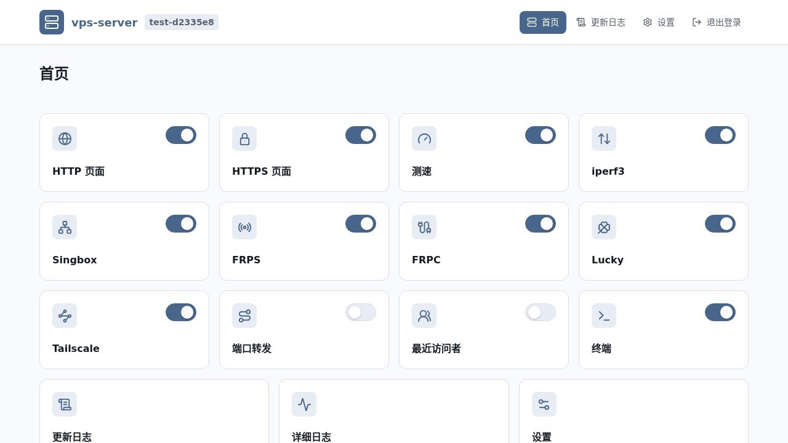

<details>
<summary>Inicio de sesión y pruebas</summary>

**Inicio de sesión**

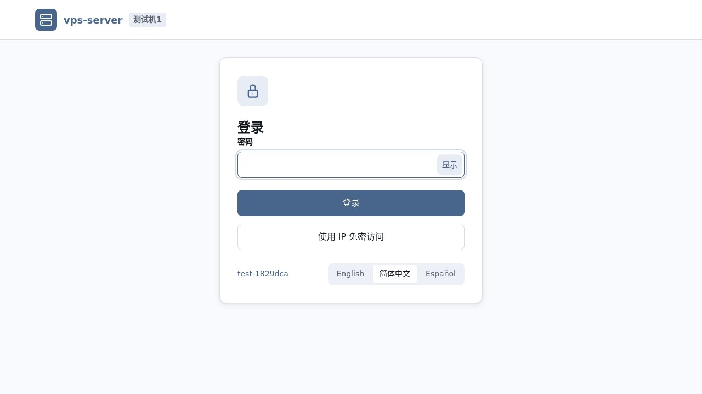

**Servidor y cliente iperf3**

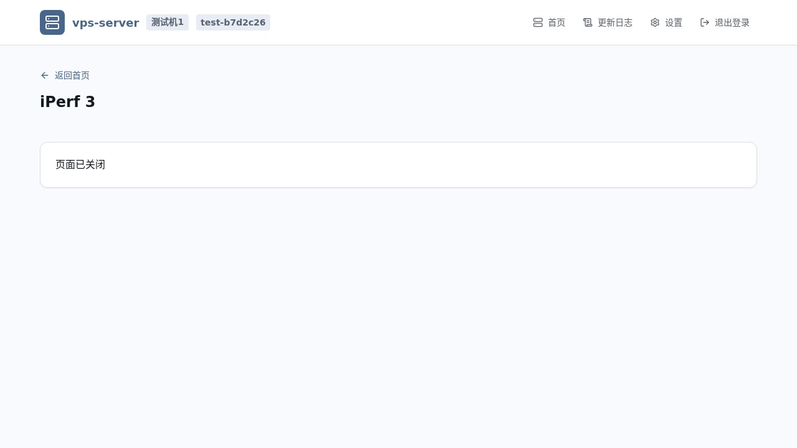

</details>

<details>
<summary>Singbox y FRP</summary>

**Vista de nodos Singbox**

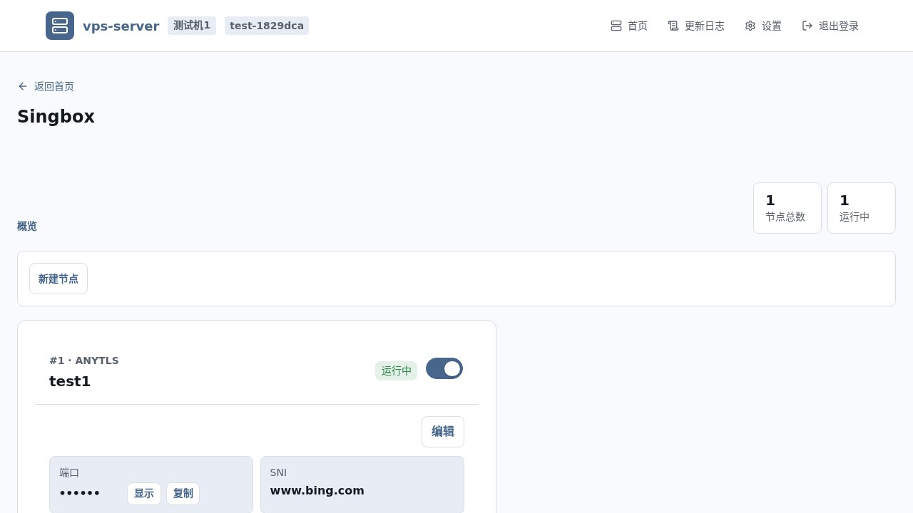

**Crear un nodo Singbox**

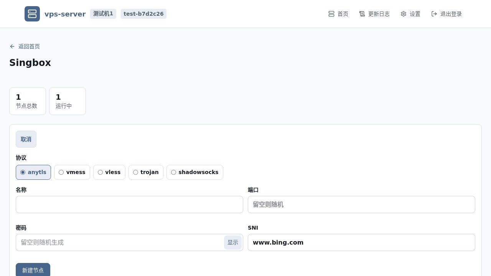

**Gestión de acceso de Singbox**

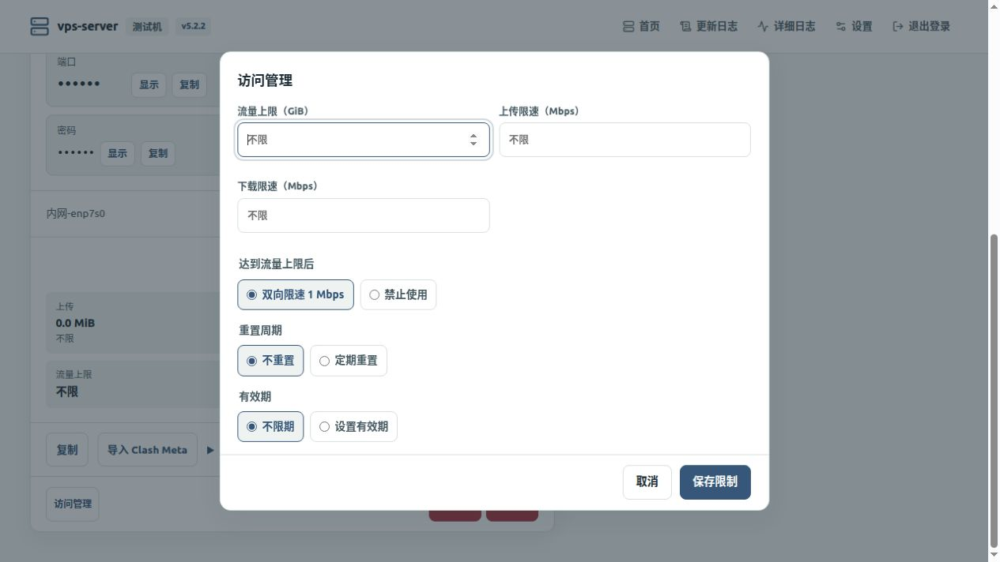

**Servidor FRPS**

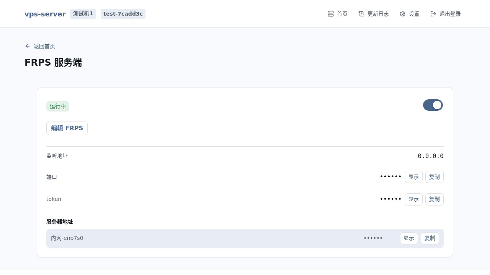

**Crear una instancia FRPC**

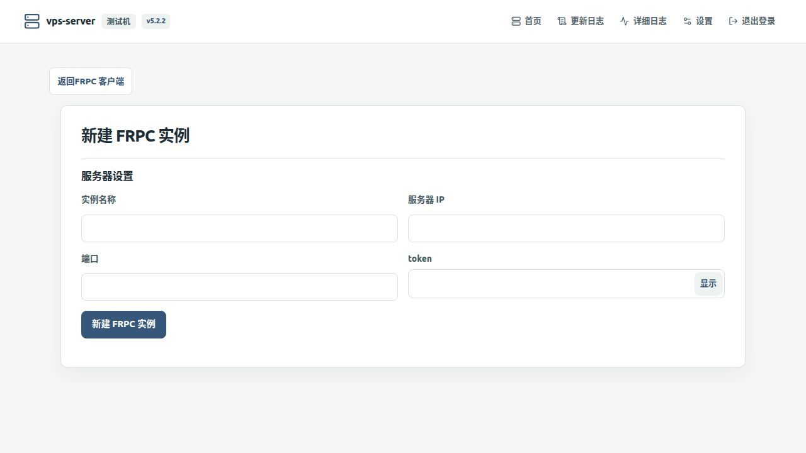

</details>

<details>
<summary>Tailscale</summary>

**Vista y formulario de conexión de Tailscale**

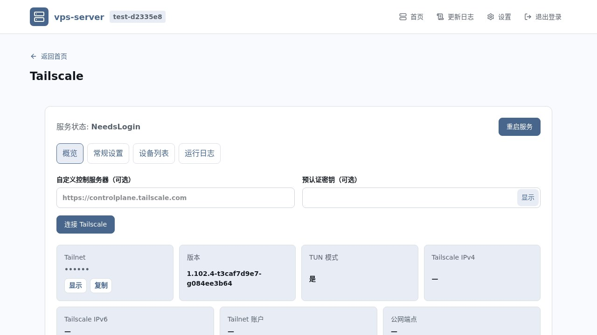

**Configuración general de Tailscale**

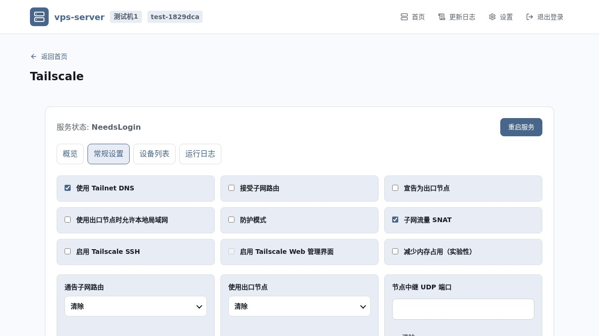

**Filtros de registros de Tailscale**

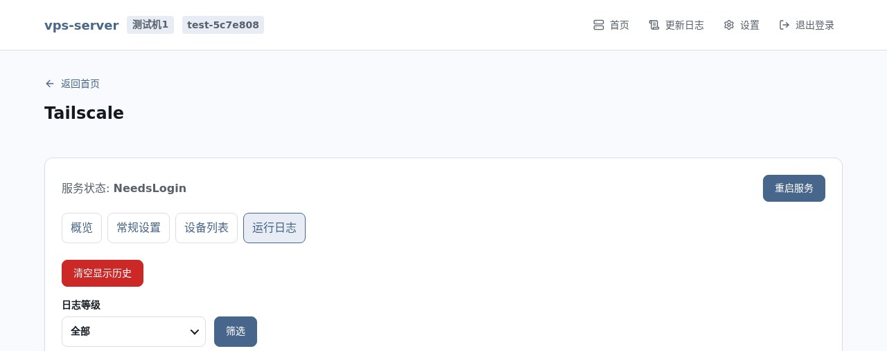

</details>

<details>
<summary>Configuración y registros</summary>

**Configuración de tema e idioma**

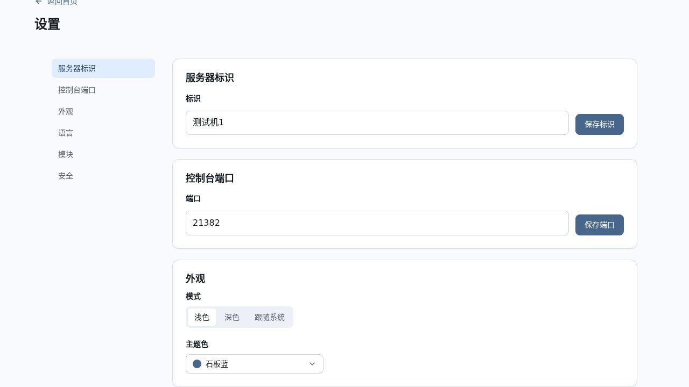

**Gestión de módulos**

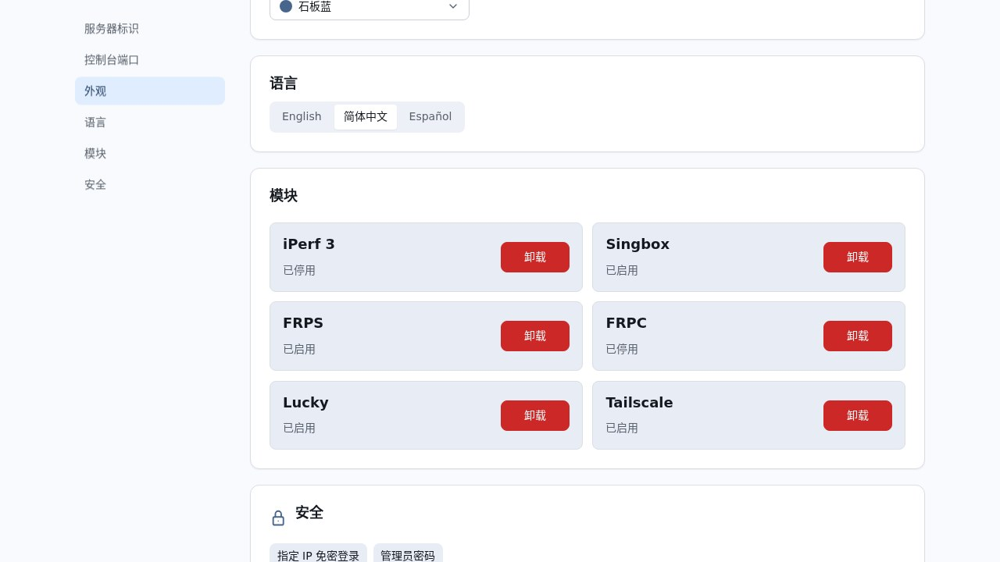

**Verificación de contraseña de administrador**

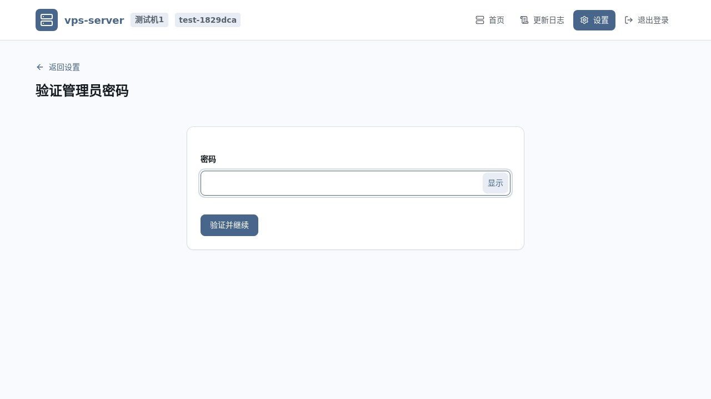

**Categorías y filtros de registros detallados**

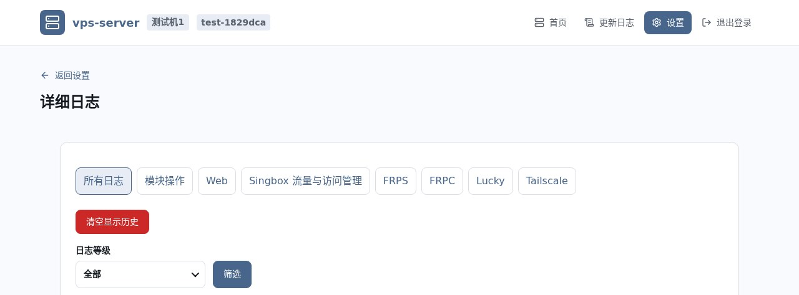

**Historial de cambios**

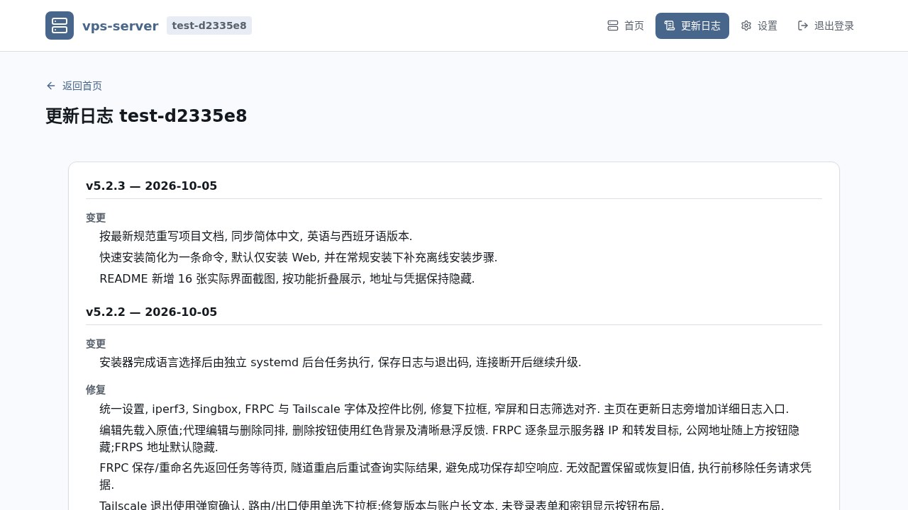

</details>

## Requisitos

Mínimo: Linux x86-64, systemd, acceso root, Python 3.9+, Bash y directorios de instalación/estado escribibles. El instalador está dirigido a Debian 11+ y Ubuntu 20.04+; otras arquitecturas no están soportadas. El reenvío de puertos necesita iptables y la contabilidad y los límites de los nodos Singbox necesitan nft; si el equipo no tiene una versión funcional, el paquete completo incluye nft/iptables de Debian 13 con cargador y glibc propios, que también funcionan sin conexión. Cambiar el puerto de la consola y detectar el puerto de administración de Lucky necesitan `ss`; el resumen de instalación y las rutas de Tailscale necesitan `ip` (ambos de iproute2). El instalador comprueba esto antes de cambiar cualquier servicio: Python inferior a 3.9 detiene la instalación, la falta de iptables (sin entorno incluido), `ss` o `ip` solo genera un aviso, y un nft inutilizable o un demonio Tailscale del sistema ya existente detienen la instalación.

Se recomienda una versión mantenida de Debian/Ubuntu, espacio para copias de seguridad y puertos abiertos para las funciones activadas. Debian 13 x86-64 se verificó en una máquina; Python 3.9 y otras distribuciones no tienen aceptación independiente. Cada versión publica dos paquetes. El paquete sin conexión incluye todos los programas de terceros; el destino solo necesita Python 3.9+, sin curl, Git, tar ni gzip y sin red. El paquete en línea es pequeño y descarga esos programas durante la instalación, verificados con SHA-256; el instalador instala con apt los iptables, iproute2 y nftables que falten. El paquete sin conexión también incluye iptables, nftables e iproute2 (`ss`, `ip`) y los usa cuando el equipo no los tiene. Crear el paquete sin conexión desde el código fuente requiere red.

## Instalación

Ejecute como root.

### Instalación rápida

Instale solo la consola Web con un comando. Añada otros módulos según necesite desde Configuración/Módulos. Este es el paquete sin conexión; para el paquete en línea use `vps-server-v5.7.0-linux-amd64-online.tar.gz` como nombre de archivo o ejecute este comando:

```bash
python3 -c 'import sys, tarfile, urllib.request; t = tarfile.open(fileobj=urllib.request.urlopen(sys.argv[1]), mode="r|gz"); t.extraction_filter = getattr(tarfile, "tar_filter", None); t.extractall("/root")' https://github.com/CharlesGool/vps-server/releases/download/v5.7.0/vps-server-v5.7.0-linux-amd64.tar.gz && VPSSRV_MODULES=web bash /root/vps-server/deploy/install.sh
```

### Instalación normal

La instalación desde código requiere compilar antes el frontend en `web/` (Node.js 24). El repositorio no contiene programas de terceros como sing-box, frp, Lucky y Tailscale; como en el paquete en línea, el instalador los descarga y verifica su SHA-256. El entorno privado nftables solo se incluye en el paquete completo. Copiar `.env` es opcional; edítelo antes de instalar si necesita personalización.

```bash
git clone --depth 1 --branch v5.7.0 https://github.com/CharlesGool/vps-server.git /root/vps-server-source
cd /root/vps-server-source
(cd web && npm ci && npm run check)
cp .env.example .env
bash deploy/install.sh
```

#### Instalación en línea

El destino solo necesita acceso a la red. El paquete pesa unos 4 MB; los demás programas se descargan durante la instalación según los módulos elegidos.

```bash
python3 -c 'import sys, tarfile, urllib.request; t = tarfile.open(fileobj=urllib.request.urlopen(sys.argv[1]), mode="r|gz"); t.extraction_filter = getattr(tarfile, "tar_filter", None); t.extractall("/root")' https://github.com/CharlesGool/vps-server/releases/download/v5.7.0/vps-server-v5.7.0-linux-amd64-online.tar.gz && VPSSRV_MODULES=web bash /root/vps-server/deploy/install.sh
```

#### Instalación sin conexión

Descargue el [paquete completo](https://github.com/CharlesGool/vps-server/releases/download/v5.7.0/vps-server-v5.7.0-linux-amd64.tar.gz) y [SHA256SUMS](https://github.com/CharlesGool/vps-server/releases/download/v5.7.0/SHA256SUMS) en una máquina con red y transfiéralos a `/root/vps-server-download/` del destino. Ejecute lo siguiente; el destino solo necesita Python 3.9+; sin red, curl, Git, tar ni gzip.

```bash
cd /root/vps-server-download
sha256sum -c SHA256SUMS
python3 -c 'import sys, tarfile; t = tarfile.open(sys.argv[1]); t.extraction_filter = getattr(tarfile, "tar_filter", None); t.extractall("/root")' vps-server-v5.7.0-linux-amd64.tar.gz
VPSSRV_MODULES=web bash /root/vps-server/deploy/install.sh
```

La pregunta de idioma al inicio continúa con el valor predeterminado tras 5 segundos sin respuesta (`VPSSRV_PROMPT_TIMEOUT` cambia los segundos; `0` espera indefinidamente), así que las instalaciones desatendidas terminan solas. Después de elegir el idioma, systemd ejecuta la instalación en segundo plano y el terminal actual muestra solo los pasos clave y, al final, la dirección de la consola y la contraseña inicial; si falla, muestra el motivo y algunas líneas relacionadas del registro. Ctrl-C o una desconexión del terminal solo detienen la vista; la instalación continúa. **DEBE** conservar el directorio fuente hasta que finalice. Tras salir de la vista, consulte el registro completo y el resultado en la ruta predeterminada:

```bash
tail -f /root/apps/vps-server/.local/install-job/install.log
cat /root/apps/vps-server/.local/install-job/exit-code
```

La ausencia de `exit-code` indica que la tarea no terminó; `0` indica éxito y otros valores, fallo. Ajuste la ruta para un `PREFIX` personalizado. Cada módulo comprueba los requisitos del equipo antes de cambiar nada (por ejemplo, Singbox necesita nftables funcional y Tailscale necesita `/dev/net/tun`) e indica el motivo y la solución si falta alguno; los módulos no instalados de la consola lo muestran por adelantado. Si el equipo no tiene un nftables capaz de leer reglas, tanto el instalador como la tarea de instalación de Singbox en la consola instalan primero `nftables` con apt, sin necesidad de comandos en el terminal; solo se detienen con un motivo si no hay apt o la instalación falla.

## Uso

Inicie sesión con la dirección y contraseña del registro. Instale componentes en Configuración/Módulos y gestione nodos, instancias FRPC o pruebas temporales. Direcciones y credenciales se ocultan por defecto; los editores cargan los valores actuales. El terminal root y la seguridad requieren verificar la contraseña. La consola solo se sirve por HTTPS. Conecte y autentique Tailscale; las rutas anunciadas requieren aprobación en Tailnet.

### Inicio de sesión con certificado de cliente

Un certificado de cliente (clave pública/privada) puede sustituir a la contraseña. En Configuración > Seguridad > Certificados de cliente, emita un certificado por dispositivo, descargue el archivo `.p12`, anote la contraseña de importación (se muestra una sola vez), impórtelo en el sistema o el navegador y reinicie el navegador por completo. Al volver a abrir la consola, el navegador pregunta qué certificado usar y la página de inicio de sesión ofrece "Entrar con certificado". El servidor solo guarda los números de serie, nunca las claves privadas de los dispositivos; revoque en la misma página los certificados perdidos o sin uso.

Cuando la conexión actual ya use un certificado, active "Exigir certificado de cliente": los dispositivos sin certificado válido no pueden abrir ni la página de inicio de sesión y la contraseña deja de servir para entrar; solo verifica de nuevo el terminal root y la configuración de seguridad. El acceso por IP sin contraseña también necesita certificado; los enlaces de suscripción de Clash no se ven afectados. Emitir certificados requiere `openssl` en el equipo; el instalador lo instala con apt si falta.

Si un certificado perdido le deja fuera, desactive el requisito como root en el servidor para recuperar el acceso con contraseña (no hace falta reiniciar; ajuste la ruta para un `PREFIX` personalizado):

```bash
python3 /root/apps/vps-server/src/web/client_cert.py disable
```

El argumento `status` muestra el estado del requisito y todos los certificados.

### Seguridad del inicio de sesión

Toda esta configuración está en Configuración > Seguridad.

- **Bloqueo por fallos**: una IP que falla la contraseña el número de veces configurado dentro de la ventana queda bloqueada un tiempo; las direcciones IPv6 cuentan juntas por /64. Cada nuevo bloqueo en un día dura diez veces más (por defecto 30 segundos, 5 minutos, 50 minutos, unas 8 horas, como máximo 24 horas). Durante el bloqueo se rechaza incluso la contraseña correcta; un inicio de sesión correcto borra el recuento de esa IP. Si todas las fuentes juntas fallan demasiado, las direcciones que nunca iniciaron sesión no pueden usar la contraseña durante un tiempo (por defecto, 20 fallos en 60 segundos la pausan 5 minutos); las direcciones conocidas, el acceso con certificado y el acceso por IP no se ven afectados. El interruptor está activado por defecto; desactivado, se siguen contando los fallos de cada IP y alcanzar el umbral solo la marca, para comprobar que la detección funciona. Cambiar el interruptor borra los bloqueos y marcas actuales; los registros están en memoria y se borran al reiniciar Web.
- **Límite de acceso a la consola**: activado, solo las IP o redes de la lista pueden conectarse a la consola y las demás se cortan antes del saludo TLS. La dirección local (loopback) siempre se permite; los equipos de la LAN, incluidas las suscripciones de Clash, también deben estar en la lista. Solo se puede activar si la dirección actual está en la lista, y no se puede quitar una entrada que cubra la conexión actual. Desactivado por defecto. Si queda fuera, desactívelo como root en el servidor (sin reiniciar; cambie la ruta si usa otro `PREFIX`):

  ```bash
  python3 /root/apps/vps-server/src/web/console_access.py disable
  ```

- **Dispositivos conectados**: muestra los dispositivos con sesión (navegador, sistema, IP, inicio y última actividad) y permite cerrar la sesión de uno o de todos los demás. Una sesión dura como máximo 12 horas y termina tras `VPSSRV_SESSION_IDLE_SECONDS` sin actividad (2 horas por defecto); escribir en el terminal cuenta como actividad.
- **Avisos de inicio de sesión**: con un servidor y una clave de Bark, los inicios de sesión desde una dirección nueva y los bloqueos se envían al móvil; el mismo aviso para la misma dirección se envía como máximo una vez por hora. La clave se guarda en el servidor y nunca se muestra en la página.
- **Registro de seguridad**: muestra los 50 inicios de sesión, bloqueos, aperturas del terminal root y cambios de seguridad más recientes; el servidor guarda los últimos 500.

Las respuestas de la consola llevan una Content-Security-Policy que solo permite los scripts propios y prohíben que otros sitios la incrusten. Detrás de un proxy inverso (`VPSSRV_TRUST_PROXY=1`), la dirección del cliente es la última entrada de `X-Forwarded-For` añadida por el proxy, y el límite de acceso comprueba esa dirección en cada solicitud.

Plantilla de configuración: [.env.example](../../.env.example). Todas las variables tienen valores predeterminados; no es obligatorio indicar credenciales. Use rutas absolutas, interruptores `0/1`, puertos `1-65535` (salvo el `0` de consola) y cantidades/duraciones enteras. Salvo `PREFIX` y el `VPSSRV_STATE_DIR` inicial, se guardan en `.env` de la raíz del estado; reinicie Web tras cambiarlos. Los valores iniciales de módulos se aplican al instalarlos.

| Parámetro | Predeterminado | Significado |
| --- | --- | --- |
| `PREFIX` | `/root/apps/vps-server` | Directorio de código, parámetro de entorno del instalador/desinstalador; no tiene efecto en `.env`. |
| `VPSSRV_STATE_DIR` | `/var/lib/vps-server` | Raíz del estado para la primera instalación; editar `.env` no migra datos. |
| `VPSSRV_DATA_DIR` | vacío | Directorio de datos; vacío usa `data/` bajo la raíz del estado. |
| `VPSSRV_CERT_DIR` | vacío | Directorio de certificados; vacío usa `certs/` bajo la raíz del estado. |
| `VPSSRV_PUBLIC_ENABLE` | `0` | Páginas públicas de accesibilidad; 1 las activa. |
| `VPSSRV_PUBLIC_HTTP_PORT` | `80` | Puerto HTTP público. |
| `VPSSRV_PUBLIC_HTTPS_PORT` | `443` | Puerto HTTPS público. |
| `VPSSRV_HOST` | `0.0.0.0` | Dirección de escucha Web. |
| `VPSSRV_CONSOLE_PORT` | `0` | Puerto de consola; 0 elige y guarda uno entre 20000-59999. |
| `VPSSRV_CONSOLE_PORT_FILE` | vacío | Archivo del puerto; vacío usa `console_port.txt` bajo la raíz del estado. |
| `VPSSRV_CONSOLE_TLS` | `1` | Fijo en 1: la consola solo usa HTTPS, con certificado autofirmado por defecto; 0 no tiene efecto y una instalación que usaba HTTP pasa a HTTPS al actualizar (mismo puerto). Un certificado autofirmado evita escuchas, pero no prueba la identidad del servidor. |
| `VPSSRV_AUTH` | `1` | Autenticación de consola; 0 permite administrar sin autenticación. |
| `VPSSRV_PASSWORD_FILE` | vacío | Archivo de contraseña; vacío usa `admin_password.txt` bajo la raíz del estado. |
| `VPSSRV_IP_ALLOWLIST_FILE` | vacío | Archivo de IP permitidas sin contraseña; vacío usa la lista predeterminada. |
| `VPSSRV_LOGIN_MAX_ATTEMPTS` | `5` | Máximo de intentos fallidos por ventana. |
| `VPSSRV_LOGIN_WINDOW_SECONDS` | `60` | Ventana de intentos fallidos en segundos. |
| `VPSSRV_LOGIN_LOCKOUT_SECONDS` | `30` | Bloqueo la primera vez que se supera el límite, en segundos; el interruptor está en Seguridad, no en `.env`. |
| `VPSSRV_LOGIN_LOCKOUT_MAX_SECONDS` | `86400` | Límite superior de los bloqueos repetidos, en segundos. |
| `VPSSRV_LOGIN_GLOBAL_MAX_ATTEMPTS` | `20` | Total de fallos de todas las fuentes en la ventana; 0 desactiva la pausa global. |
| `VPSSRV_LOGIN_GLOBAL_LOCKOUT_SECONDS` | `300` | Pausa global en segundos. |
| `VPSSRV_SESSION_IDLE_SECONDS` | `7200` | Tiempo de inactividad de la sesión en segundos; 0 lo desactiva. |
| `VPSSRV_TLS_CERT` | vacío | Ruta del certificado TLS propio; indique también la clave. |
| `VPSSRV_TLS_KEY` | vacío | Ruta de clave TLS propia; sin el par se genera un certificado autofirmado. |
| `VPSSRV_IPERF_ENABLE` | `1` | Activación de iperf3. |
| `VPSSRV_IPERF_PORT` | `5201` | Puerto del servidor temporal. |
| `VPSSRV_IPERF_DEFAULT_MINUTES` | `10` | Duración predeterminada en minutos. |
| `VPSSRV_IPERF_MAX_MINUTES` | `60` | Duración máxima en minutos. |
| `VPSSRV_PORTFWD_ENABLE` | `1` | Activación de reenvío de puertos. |
| `VPSSRV_PORTFWD_MAX_RULES` | `20` | Máximo de reglas de reenvío guardadas. |
| `VPSSRV_TRACK_CONNECTIONS` | `1` | Recopilar conexiones TCP del núcleo. |
| `VPSSRV_CONN_POLL_SECONDS` | `5` | Intervalo de muestreo de conexiones en segundos. |
| `VPSSRV_TRUST_PROXY` | `0` | Confiar en cabeceras del proxy; solo con un proxy controlado, desactiva el acceso por IP sin contraseña. |
| `VPSSRV_MAX_TEST_MB` | `200` | Límite de transferencia por prueba Web, en MB. |
| `VPSSRV_TEST_SECONDS` | `10` | Duración de medición, en segundos. |
| `VPSSRV_WARMUP_SECONDS` | `2` | Segundos de calentamiento excluidos del resultado. |
| `VPSSRV_DOWNLOAD_STREAMS` | `6` | Flujos de descarga paralelos. |
| `VPSSRV_UPLOAD_STREAMS` | `3` | Flujos de subida paralelos. |
| `VPSSRV_PING_SAMPLES` | `20` | Número de muestras de latencia. |
| `VPSSRV_DEFAULT_LANG` | `en` | Idioma predeterminado: `en`, `zh_cn`, `es`. |
| `VPSSRV_PROXY_CONFIG` | `/etc/vps-server-proxy/config.json` | Ruta de configuración del proxy unificado. |
| `VPSSRV_PROXY_SERVICE` | `vps-server-proxy.service` | Nombre del servicio proxy unificado. |
| `PROXY_PROTOCOLS` | vacío | Subconjunto separado por comas; vacío instala los cinco protocolos. |
| `PROXY_SNI` | `www.bing.com` | SNI TLS inicial para VMess, VLESS y Trojan. |
| `PROXY_ANYTLS_PORT` | vacío | Puerto inicial del protocolo; vacío lo selecciona automáticamente. |
| `PROXY_ANYTLS_PASSWORD` | vacío | Credencial inicial del protocolo; vacío la genera. |
| `PROXY_VMESS_PORT` | vacío | Puerto inicial del protocolo; vacío lo selecciona automáticamente. |
| `PROXY_VMESS_UUID` | vacío | Credencial inicial del protocolo; vacío la genera. |
| `PROXY_VLESS_PORT` | vacío | Puerto inicial del protocolo; vacío lo selecciona automáticamente. |
| `PROXY_VLESS_UUID` | vacío | Credencial inicial del protocolo; vacío la genera. |
| `PROXY_TROJAN_PORT` | vacío | Puerto inicial del protocolo; vacío lo selecciona automáticamente. |
| `PROXY_TROJAN_PASSWORD` | vacío | Credencial inicial del protocolo; vacío la genera. |
| `PROXY_SS_PORT` | vacío | Puerto inicial del protocolo; vacío lo selecciona automáticamente. |
| `PROXY_SS_PASSWORD` | vacío | Credencial inicial del protocolo; vacío la genera. |

El instalador también acepta `VPSSRV_MODULES` (lista `web,iperf3,proxy,frps,lucky,tailscale`; valor inicial `web`, conserva módulos al reinstalar) y `SERVICE_NAME` (predeterminado `vps-server-web`). El argumento `KEEP_DATA=1` conserva los datos al desinstalar. No son parámetros de Web.

Para mantener el código, ejecute `python3 tools/check-project/check_project.py`. Requiere Git, Bash, Python 3.9+ y Node.js 24; Node.js compila el frontend y comprueba JavaScript y no es necesario para ejecutar el servidor. Use `--node /ruta/absoluta/node` si no está en PATH. Los directorios `tools/build_styles`, `tools/build_offline`, `tools/verify_dependencies` pasan a llamarse `build-styles`, `build-offline`, `verify-dependencies`, respectivamente; sustituya las rutas en los comandos antiguos de mantenimiento. Los comandos de instalación no cambian. La comprobación no inicia servicios ni sustituye la aceptación del despliegue.

Antes de instalar el código de desarrollo, ejecute `npm ci && npm run check` en `web/` (la compilación requiere Node.js 24). El paquete completo ya incluye el frontend; el servidor no necesita Node.js. La comprobación unificada incluye diseño, tipos y compilación frontend.

## Actualización

Las versiones de esquema 1, v5.1.1 de prueba y v5.2.x, se actualizan con los pasos anteriores. Copie la raíz del estado, `/etc/vps-server-proxy`, `/etc/vps-server-frps`, configuraciones FRPC y Lucky. Extraiga fuera del directorio instalado y use el mismo `PREFIX` y raíz del estado. Se conservan contraseñas, puertos, certificados, sesiones y módulos; el directorio fuente ya no almacena datos persistentes.

v5.1.0 y anteriores usan el esquema antiguo, sin migración automática. **DEBE** respaldar el directorio antiguo y las configuraciones, instalar de nuevo y restaurar manualmente los ajustes necesarios. Si falta el localizador de estado o se detecta el esquema antiguo, se rechaza la actualización directa; no elimine antes el directorio antiguo.

Compruebe el código de salida `0`, que `systemctl is-active vps-server-web` indique `active`, la versión v5.7.0, la contraseña original, las configuraciones de nodos/FRPC y los módulos y puertos. Ajuste el nombre del servicio si lo personalizó. Conserve registros y copias ante un fallo; una ejecución parcial no es éxito.

## Desinstalación

El primer bloque desinstala servicios conservando programa, configuración y datos; el segundo elimina todo. Indique el mismo `PREFIX` personalizado o ejecute desde un directorio fuente conservado.

```bash
cd /root/apps/vps-server/installer-source
KEEP_DATA=1 bash deploy/uninstall.sh
```

```bash
cd /root/apps/vps-server/installer-source
bash deploy/uninstall.sh
```

Ambos detienen servicios y liberan puertos del proyecto. La eliminación completa borra además el estado predeterminado, configuraciones FRPS/proxy/FRPC, ajustes y tareas Lucky e identidad Tailscale. No elimina automáticamente datos externos a la raíz del estado. Revise la pertenencia de instancias FRPC compartidas. Un fallo al limpiar el cortafuegos detiene la eliminación completa y conserva los registros de pertenencia.

## Agradecimientos

Este proyecto utiliza o toma como referencia: [LibreSpeed](https://github.com/librespeed/speedtest), [sing-box](https://github.com/SagerNet/sing-box), [frp](https://github.com/fatedier/frp), [Lucky](https://github.com/gdy666/lucky), [Tailscale](https://github.com/tailscale/tailscale), [iperf3](https://github.com/esnet/iperf), [qrcode-generator](https://github.com/kazuhikoarase/qrcode-generator), [xterm.js](https://github.com/xtermjs/xterm.js), [Fontsource](https://github.com/fontsource/font-files), [Lucide](https://github.com/lucide-icons/lucide).

Consulte [Avisos de terceros](THIRD_PARTY_NOTICES.md) para atribución y condiciones originales.

## Licencia

GNU General Public License v3.0, SPDX: `GPL-3.0-only`. Texto íntegro: [LICENSE](../../LICENSE). Los componentes de terceros conservan sus licencias originales. Este proyecto no está asociado ni respaldado por sing-box/SagerNet o LibreSpeed.
