# vps-server

[简体中文](../../README.md) | [English](../en/README.md) | **Español**

Administre pruebas de velocidad, proxies, FRP y Tailscale desde una consola Web.

[](../../LICENSE) [](https://github.com/CharlesGool/vps-server/releases/tag/v7.5.0)

## Documentación

- Descripción general del proyecto: [README](README.md)

- Justificación del diseño: [DESIGN](DESIGN.md)

- Estado del proyecto: [LOG](LOG.md)
- Registros históricos: [HISTORY](HISTORY.md)
- Historial de cambios: [CHANGELOG](CHANGELOG.md)

- Avisos de terceros: [THIRD_PARTY_NOTICES](THIRD_PARTY_NOTICES.md)

## Introducción

- Pruebas de subida/bajada en el navegador, registros de visitantes y pruebas iperf3 de cliente y servidor con duración limitada.
- Nodos Singbox para AnyTLS, VMess, VLESS, Trojan y Shadowsocks, con enlaces, cuotas, límites de velocidad y caducidad; los nodos nuevos solo pueden acceder a Internet público por defecto, y para acceder a la red interna o al propio equipo se cambia en el alcance de acceso del nodo.
- Servidor FRPS (contabilidad de tráfico, cuota, límites de velocidad y vigencia como un nodo Singbox, medidos en bindPort), instancias FRPC y proxies TCP/UDP y estado y dispositivos de Tailscale.
- Reenvío de dominios: reenvía HTTPS por subdominio a un puerto local (por ejemplo, un puerto de frps) o a la propia consola. Incluye Caddy, que solicita certificados de Let's Encrypt automáticamente, y mantiene los registros DNS con la API de Cloudflare (solo DNS; comprueba la IP pública del equipo cada 5 minutos). Se pueden añadir varios tokens de Cloudflare (por ejemplo, si los dominios están en cuentas distintas) y cada sitio usa automáticamente el token que gestiona su dominio principal. Cada sitio se puede activar o desactivar, editar, vincular a varios dominios, limitar por IP de origen o proteger con contraseña, y su servidor de destino puede ser HTTPS; hay registro de accesos, historial de cambios y avisos de Bark (cambio de IP, fallo de DNS, certificado a punto de caducar). Al activarlo, Caddy ocupa 80/443 y la página pública de accesibilidad pasa a servirla Caddy (véase más abajo).
- Certificado IP: un interruptor propio en el inicio que solicita un certificado de Let's Encrypt para la IPv4 pública del equipo; la dirección `https://IP:puerto` de la consola pasa a usarlo y el navegador deja de avisar de que el certificado no es seguro. No necesita dominio ni token de Cloudflare, solo que el puerto 80 sea accesible desde internet; comparte el Caddy incluido con el reenvío de dominios (requiere instalar el módulo de reenvío de dominios), y Caddy funciona y ocupa 80/443 mientras cualquiera de los dos esté activado. En ese caso, el interruptor de página pública del inicio sigue funcionando y Caddy devuelve la página directamente: el puerto 80 la muestra para la IP y para cualquier nombre no configurado (sin redirigir a HTTPS, para poder comprobar si el propio puerto 80 es accesible) y el puerto 443 la muestra solo para `https://IP-del-equipo/` mientras el certificado IP esté activado.
- Mini nube, la prueba de velocidad, el reenvío de dominios, iperf3, el reenvío de puertos, FRPC y Tailscale tienen la misma contabilidad y los mismos límites de tráfico que los nodos Singbox (al llegar al límite, reducir a 1 Mbps o cortar; límites de velocidad de subida y bajada; periodo de validez; ciclo de reinicio), configurados en "Límites de tráfico" de cada página; el tráfico del reenvío de puertos y el que se reenvía por Tailscale entra y sale del servidor, así que cuenta dos veces.
- Módulos opcionales, reenvío de puertos, Mini nube con enlaces de descarga sin contraseña, registros detallados, terminal root con contraseña, tres idiomas y temas.
- Copia de configuración: un clic o una programación diaria guarda toda la configuración (certificados, nodos, FRP, la sesión de Tailscale; no el código ni los archivos de Mini Drive), con descarga, subida, restauración y retención rotativa; el instalador copia la configuración antes de actualizar. Las tareas programadas ejecutan comandos como root cada cierto tiempo, a diario, cada semana o cada mes (al segundo, o con un cron), o solo una vez, con tiempo límite, protección contra solapamiento, historial y avisos de fallo por Bark.
- Bloqueos crecientes tras fallos de inicio de sesión, límite de acceso a la consola, gestión de dispositivos conectados, registro de seguridad y avisos de Bark.
- Recursos (CPU, memoria, disco, carga, velocidad de red, temperatura, GPU NVIDIA, con gráficas en tiempo real y de los últimos 15 minutos) y alertas de recursos por Bark; información del sistema y nombre del equipo, actualizaciones del sistema (apt), procesos, servicios de systemd y sus registros, puertos en escucha (una página cada uno), los registros de inicio de sesión SSH en la página de visitas recientes; un gestor de archivos para explorar y administrar como root los archivos del servidor; tokens de API y la [API de tokens](API.md), y una página de gestión central para ver otros equipos desde una sola consola y actualizarlos en lote.
- Las instalaciones nuevas incluyen solo Web; las páginas públicas están desactivadas. La tarjeta «Página pública» del inicio activa o desactiva juntas las páginas HTTP y HTTPS con un solo interruptor. Consulte [LOG](LOG.md#errores) para problemas y límites de verificación.

### Capturas de pantalla

Capturas de la compilación de prueba previa a v5.3.0 en el entorno de prueba con la interfaz en chino simplificado. Muestran módulos instalados, formularios de creación y Tailscale sin iniciar sesión; la instalación predeterminada sigue incluyendo solo Web. Las direcciones y credenciales permanecen ocultas, y las capturas de registros muestran solo categorías y filtros.

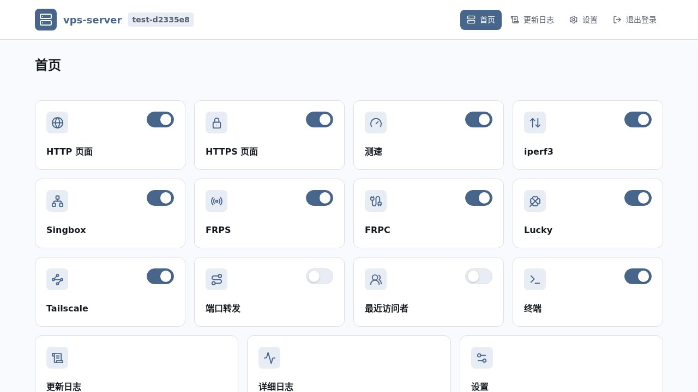

<details>
<summary>Inicio de sesión y pruebas</summary>

**Inicio de sesión**

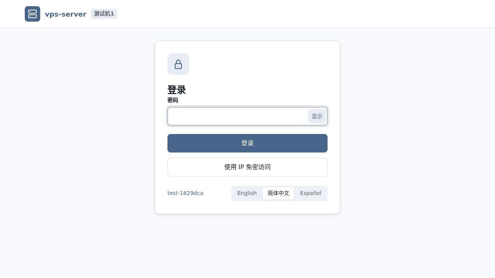

**Servidor y cliente iperf3**

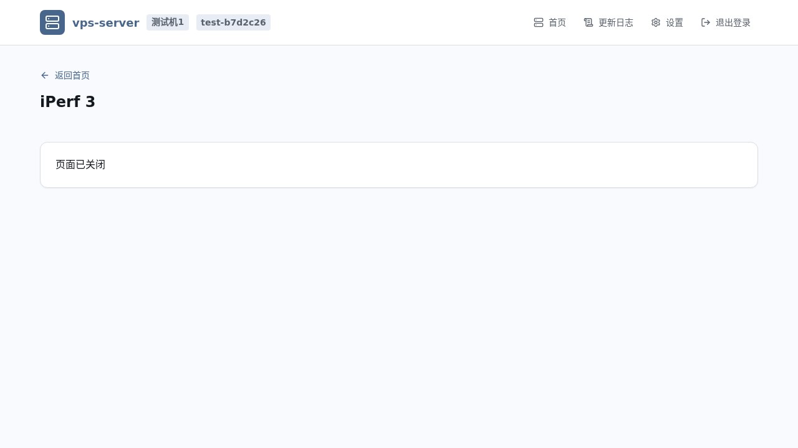

</details>

<details>
<summary>Singbox y FRP</summary>

**Vista de nodos Singbox**

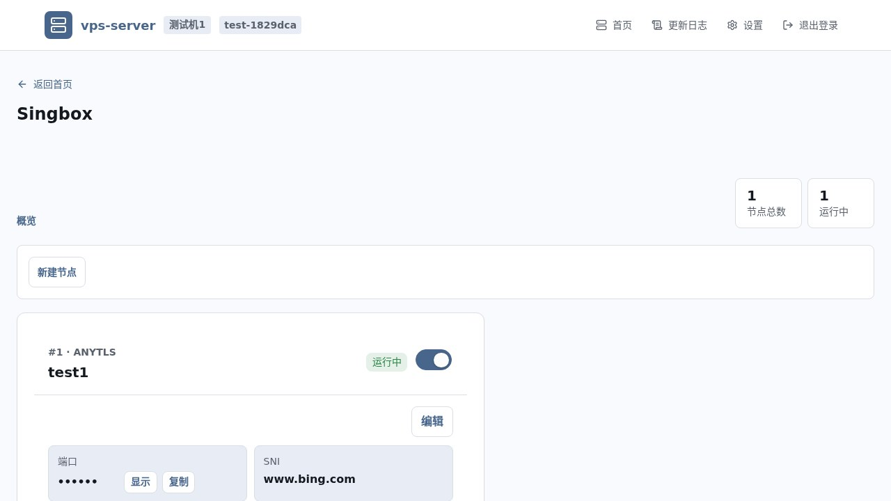

**Crear un nodo Singbox**

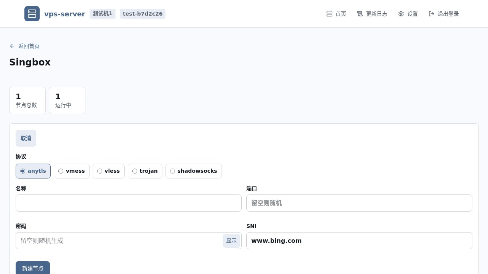

**Gestión de acceso de Singbox**

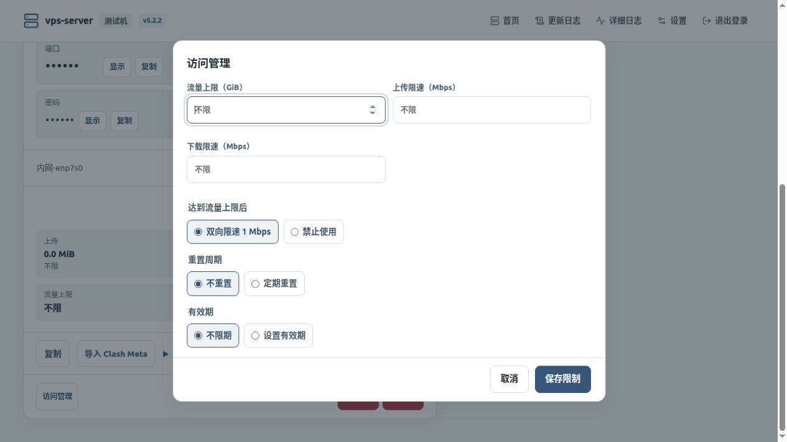

**Servidor FRPS**

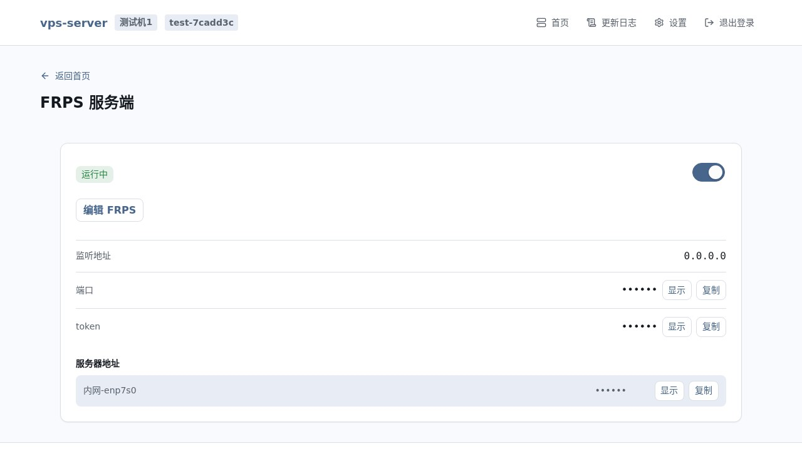

**Crear una instancia FRPC**

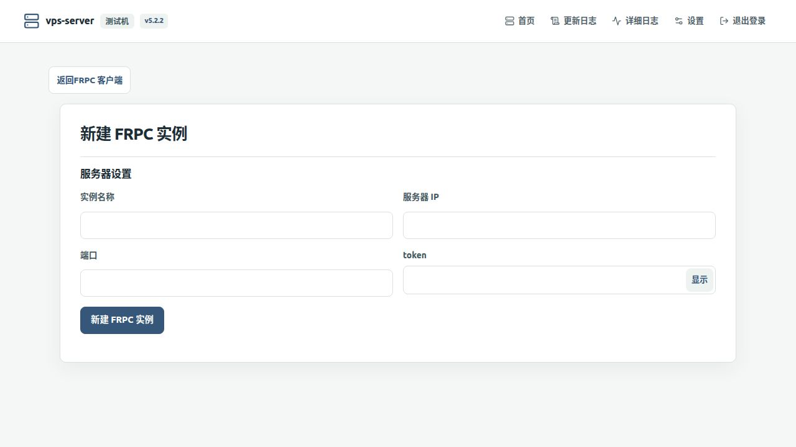

</details>

<details>
<summary>Tailscale</summary>

**Vista y formulario de conexión de Tailscale**

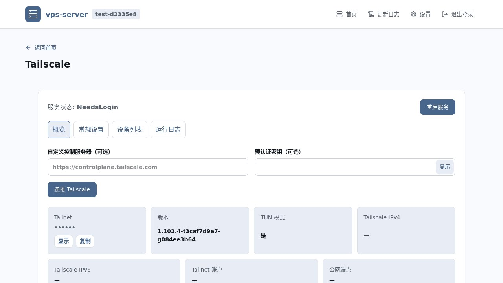

**Configuración general de Tailscale**

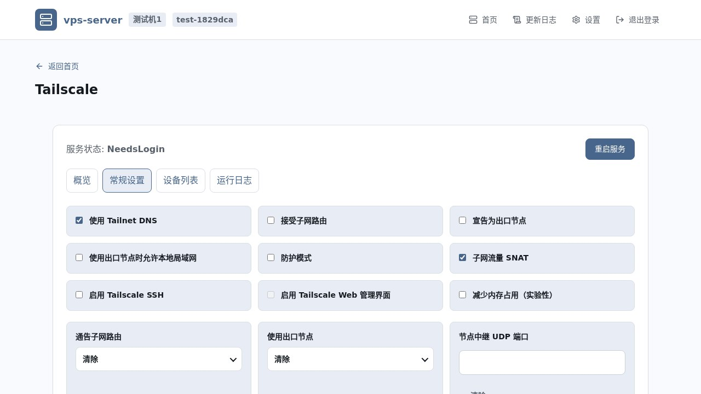

**Filtros de registros de Tailscale**

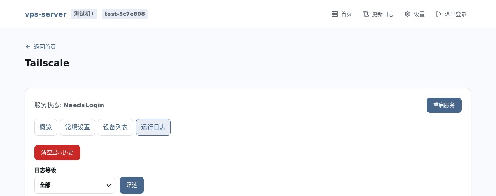

</details>

<details>
<summary>Configuración y registros</summary>

**Configuración de tema e idioma**

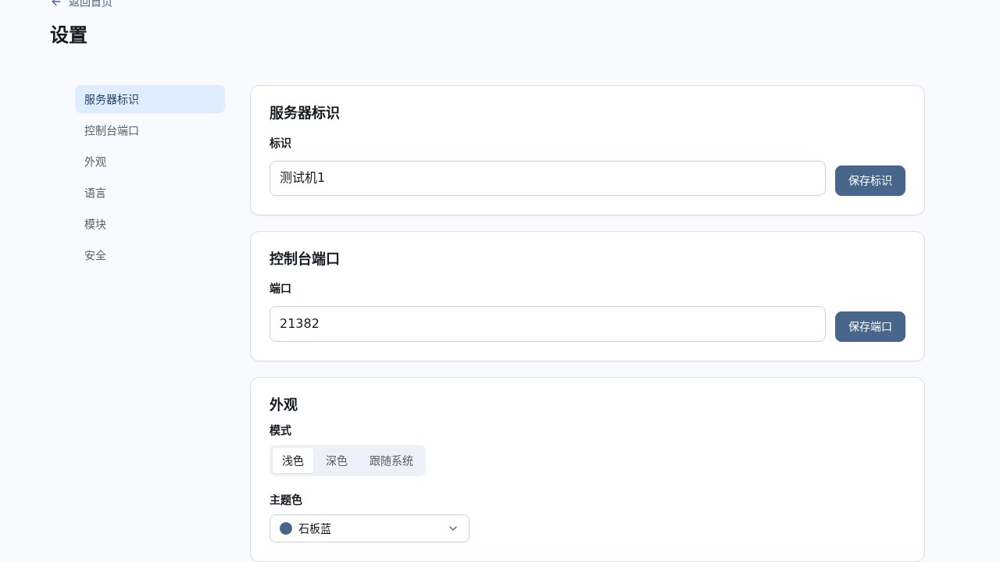

**Gestión de módulos**

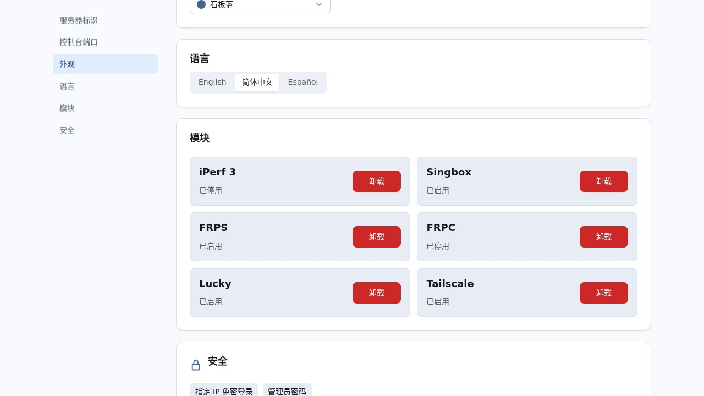

**Verificación de contraseña de administrador**

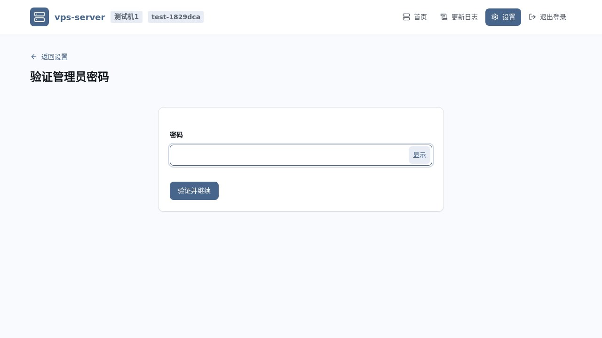

**Categorías y filtros de registros detallados**

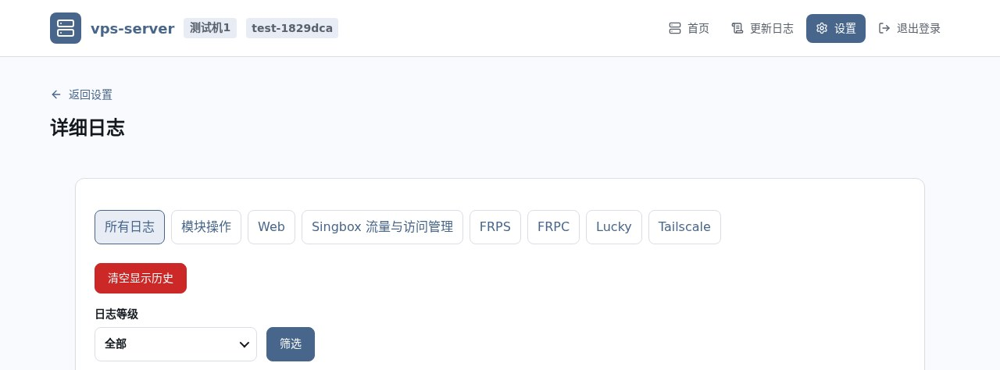

**Historial de cambios**

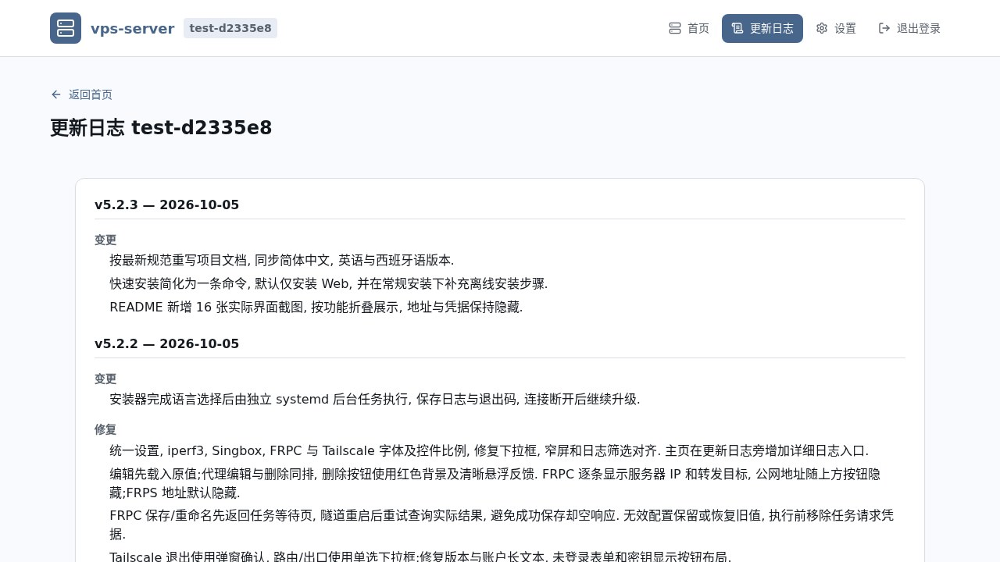

</details>

## Requisitos

Mínimo: Linux x86-64, systemd, acceso root, Python 3.9+, Bash y directorios de instalación/estado escribibles. El instalador está dirigido a Debian 11+ y Ubuntu 22.04+ (Ubuntu 20.04 incluye Python 3.8, que no cumple el requisito); otras arquitecturas no están soportadas. El reenvío de puertos necesita iptables, y la contabilidad y los límites de los nodos Singbox y de FRPS necesitan nft; si el equipo no tiene una versión funcional, el paquete completo incluye nft/iptables de Debian 13 con cargador y glibc propios, que también funcionan sin conexión. Cambiar el puerto de la consola y detectar si el puerto de destino está escuchando necesitan `ss`; el resumen de instalación y las rutas de Tailscale necesitan `ip` (ambos de iproute2). Versiones mínimas del sistema: Bash 4.1, systemd 240, SQLite 3.24 y la biblioteca OpenSSL 1.1.1 que usa Python, y Python 3.9+ tanto en `/usr/bin/python3` como en el `python3` del PATH; deben existir flock, sha256sum, base64, getent, install, mktemp y systemd-run. El paquete en línea también necesita certificados CA (ca-certificates). Un `ip`/`ss` del equipo sin rutas JSON o sin `-H` cede ante la copia incluida. Un iperf3 del equipo solo se usa si no hay copia incluida y debe ser 3.1+. El instalador comprueba esto antes de cambiar cualquier servicio: un mínimo no cumplido o Python inferior a 3.9 detiene la instalación, la falta de iptables (sin entorno incluido), `ss` o `ip` solo genera un aviso, y un nft inutilizable o un demonio Tailscale del sistema ya existente detienen la instalación.

Se recomienda una versión mantenida de Debian/Ubuntu, espacio para copias de seguridad y puertos abiertos para las funciones activadas. Debian 13 x86-64 se verificó en una máquina; Python 3.9 y otras distribuciones no tienen aceptación independiente. Cada versión publica dos paquetes. El paquete sin conexión incluye todos los programas de terceros; el destino solo necesita Python 3.9+, sin curl, Git, tar ni gzip y sin red. El paquete en línea es pequeño y descarga esos programas durante la instalación, verificados con SHA-256; el instalador instala con apt los iptables, iproute2 y nftables que falten. El paquete sin conexión también incluye iptables, nftables e iproute2 (`ss`, `ip`) y los usa cuando el equipo no los tiene. Crear el paquete sin conexión desde el código fuente requiere red.

## Instalación

Ejecute como root.

### Instalación rápida

Instale solo la consola Web con un comando. Añada otros módulos según necesite desde Configuración/Módulos. Este es el paquete sin conexión; para el paquete en línea use `vps-server-v7.5.0-linux-amd64-online.tar.gz` como nombre de archivo o ejecute este comando:

```bash
python3 -c 'import sys, tarfile, urllib.request; t = tarfile.open(fileobj=urllib.request.urlopen(sys.argv[1]), mode="r|gz"); t.extraction_filter = getattr(tarfile, "tar_filter", None); t.extractall("/root")' https://github.com/CharlesGool/vps-server/releases/download/v7.5.0/vps-server-v7.5.0-linux-amd64.tar.gz && VPSSRV_MODULES=web bash /root/vps-server/deploy/install.sh
```

### Instalación normal

La instalación desde código requiere compilar antes el frontend en `web/` (Node.js 24). El repositorio no contiene programas de terceros como sing-box, frp, Caddy y Tailscale; como en el paquete en línea, el instalador los descarga y verifica su SHA-256. El entorno privado nftables solo se incluye en el paquete completo. Copiar `.env` es opcional; edítelo antes de instalar si necesita personalización.

```bash
git clone --depth 1 --branch v7.5.0 https://github.com/CharlesGool/vps-server.git /root/vps-server-source
cd /root/vps-server-source
(cd web && npm ci && npm run check)
cp .env.example .env
bash deploy/install.sh
```

#### Instalación en línea

El destino solo necesita acceso a la red. El paquete pesa unos 4 MB; los demás programas se descargan durante la instalación según los módulos elegidos. Si una descarga de GitHub sigue por debajo de 200 KB/s tras 15 segundos, la instalación pasa a los espejos gh-proxy.com y ghfast.top (para servidores en China continental), y la descarga se verifica igualmente con SHA-256; defina `VPSSRV_GITHUB_MIRROR=https://su.espejo/` para probar antes su propio espejo, o `none` para no usar espejos. El comando de instalación de arriba también descarga de GitHub; en China continental puede sustituir su `https://github.com/` por `https://gh-proxy.com/https://github.com/`.

```bash
python3 -c 'import sys, tarfile, urllib.request; t = tarfile.open(fileobj=urllib.request.urlopen(sys.argv[1]), mode="r|gz"); t.extraction_filter = getattr(tarfile, "tar_filter", None); t.extractall("/root")' https://github.com/CharlesGool/vps-server/releases/download/v7.5.0/vps-server-v7.5.0-linux-amd64-online.tar.gz && VPSSRV_MODULES=web bash /root/vps-server/deploy/install.sh
```

#### Instalación sin conexión

Descargue el [paquete completo](https://github.com/CharlesGool/vps-server/releases/download/v7.5.0/vps-server-v7.5.0-linux-amd64.tar.gz) y [SHA256SUMS](https://github.com/CharlesGool/vps-server/releases/download/v7.5.0/SHA256SUMS) en una máquina con red y transfiéralos a `/root/vps-server-download/` del destino. Ejecute lo siguiente; el destino solo necesita Python 3.9+; sin red, curl, Git, tar ni gzip.

```bash
cd /root/vps-server-download
sha256sum -c --ignore-missing SHA256SUMS
python3 -c 'import sys, tarfile; t = tarfile.open(sys.argv[1]); t.extraction_filter = getattr(tarfile, "tar_filter", None); t.extractall("/root")' vps-server-v7.5.0-linux-amd64.tar.gz
VPSSRV_MODULES=web bash /root/vps-server/deploy/install.sh
```

La pregunta de idioma al inicio continúa con el valor predeterminado tras 5 segundos sin respuesta (`VPSSRV_PROMPT_TIMEOUT` cambia los segundos; `0` espera indefinidamente), así que las instalaciones desatendidas terminan solas. Después de elegir el idioma, systemd ejecuta la instalación en segundo plano y el terminal actual muestra solo los pasos clave y, al final, la dirección de la consola y la contraseña inicial; si falla, muestra el motivo y algunas líneas relacionadas del registro. La contraseña se guarda cifrada en el servidor; después se consulta con `python3 /root/apps/vps-server/src/web/secure_store.py show-password`. Ctrl-C o una desconexión del terminal solo detienen la vista; la instalación continúa, y también al actualizar con `upgrade.py`: el paquete descomprimido se conserva hasta que termina la tarea en segundo plano y se limpia en la siguiente actualización. Si una primera instalación falla durante la descarga o la comprobación del equipo, todavía no se ha cambiado nada: corrija la causa y vuelva a ejecutarla; si una actualización falla después de detener la consola, el instalador la vuelve a iniciar. **DEBE** conservar el directorio fuente hasta que finalice. Tras salir de la vista, consulte el registro completo y el resultado en la ruta predeterminada:

```bash
tail -f /root/apps/vps-server/.local/install-job/install.log
cat /root/apps/vps-server/.local/install-job/exit-code
```

La ausencia de `exit-code` indica que la tarea no terminó; `0` indica éxito y otros valores, fallo. Ajuste la ruta para un `PREFIX` personalizado. Cada módulo comprueba los requisitos del equipo antes de cambiar nada (por ejemplo, Singbox necesita nftables funcional y Tailscale necesita `/dev/net/tun`) e indica el motivo y la solución si falta alguno; los módulos no instalados de la consola lo muestran por adelantado. Si el equipo no tiene un nftables capaz de leer reglas, tanto el instalador como la tarea de instalación de Singbox en la consola instalan primero `nftables` con apt, sin necesidad de comandos en el terminal; solo se detienen con un motivo si no hay apt o la instalación falla.

## Uso

Inicie sesión con la dirección y contraseña del registro. Instale componentes en Configuración/Módulos y gestione nodos, instancias FRPC o pruebas temporales. Direcciones y credenciales se ocultan por defecto; los editores cargan los valores actuales. El terminal root y la seguridad requieren verificar la contraseña. La consola solo se sirve por HTTPS. Conecte y autentique Tailscale; las rutas anunciadas requieren aprobación en Tailnet.

### Inicio de sesión con certificado de cliente

Un certificado de cliente (clave pública/privada) puede sustituir a la contraseña. En Configuración > Seguridad > Certificados de cliente, emita un certificado por dispositivo, descargue el archivo `.p12`, anote la contraseña de importación (se muestra una sola vez), impórtelo en el sistema o el navegador y reinicie el navegador por completo. Al volver a abrir la consola, el navegador pregunta qué certificado usar y la página de inicio de sesión ofrece "Entrar con certificado". Los nombres de los certificados incluyen el nombre del host para distinguirlos en el selector. El primer paso de la página que aparece tras emitirlo ofrece archivos de configuración en un clic para Windows, macOS y Linux: importan el certificado y hacen que el navegador lo elija solo; los pasos manuales con el `.p12` están en "Importación manual". Un dispositivo que ya tiene el certificado puede descargar una versión sin él en "No elegir el certificado cada vez", en la tarjeta de certificados, para activar solo la selección automática. Cada dispositivo usa su propio certificado; para un dispositivo nuevo, genere otro en esta página. Windows: doble clic en el `.cmd` (sin permisos de administrador; Chrome y Edge). macOS: doble clic en el `.mobileconfig` y luego instálalo en Ajustes del Sistema > Privacidad y seguridad > Perfiles (Chrome y Edge). macOS solo aplica el valor de un perfil para cada política del navegador, así que el perfil de cada host lleva la misma regla (cualquier dirección, organización del sujeto vps-server) y la consola solo nombra su propia CA en el handshake TLS, de modo que Chrome solo considera el certificado de ese host; los certificados emitidos antes de v7.1.1 no tienen ese campo de organización y en un Mac hay que volver a emitirlos y quitar los perfiles antiguos. Linux: ejecuta el `.sh` con `bash` en una terminal (usa sudo para el archivo de políticas; Chrome, Chromium y Edge; importar necesita libnss3-tools). El servidor solo guarda los números de serie, nunca las claves privadas de los dispositivos; revoque en la misma página los certificados perdidos o sin uso.

Cuando la conexión actual ya use un certificado, active "Exigir certificado de cliente": los dispositivos sin certificado válido no pueden abrir ni la página de inicio de sesión y la contraseña deja de servir para entrar; solo verifica de nuevo el terminal root y la configuración de seguridad. El acceso por IP sin contraseña también necesita certificado; los enlaces de suscripción de Clash no se ven afectados. Los certificados los firma el OpenSSL 3.5 LTS estático incluido en el paquete, con una configuración mínima propia, así que la versión de openssl y el openssl.cnf del equipo no influyen. Cada autoridad de certificación pasa antes una autoprueba de TLS mutuo con la biblioteca TLS del equipo; una autoridad inválida creada por un openssl antiguo se reemplaza, sus certificados se marcan como revocados y se desactiva "Exigir certificado de cliente". `client_cert.py check` muestra el openssl usado y el resultado de la autoprueba.

Si un certificado perdido le deja fuera, desactive el requisito como root en el servidor para recuperar el acceso con contraseña (no hace falta reiniciar; ajuste la ruta para un `PREFIX` personalizado):

```bash
python3 /root/apps/vps-server/src/web/client_cert.py disable
```

El argumento `status` muestra el estado del requisito y todos los certificados.

### Mini nube

"Mini nube", en la página de inicio, está desactivado por defecto. Al activarlo, guarda archivos temporalmente en este servidor y crea enlaces de descarga sin contraseña, por ejemplo para que un servidor que no llega a GitHub descargue desde aquí. Los archivos llegan de dos formas: subidos desde un navegador, o indicando una URL http/https para que el servidor la descargue por sí mismo (en segundo plano; se puede cerrar el navegador; no se aceptan direcciones de bucle local, de red interna, de enlace local ni de metadatos de proveedores de nube, cada conexión y redirección solo se conecta a direcciones ya comprobadas y no se usa el proxy de las variables de entorno). El límite es de 5 GiB por defecto y se cambia en la página; sea cual sea, siempre quedan al menos 500 MiB libres en el disco. Cada archivo puede tener varios enlaces de descarga, cada uno con caducidad (5, 10 o 30 minutos; 1, 2 o 5 horas; 1, 7 o 30 días; o nunca) y un límite de descargas opcional, y cualquiera se puede revocar en todo momento. Los enlaces tienen la forma `https://<dirección de la consola>/f/<token>/<nombre del archivo>`; quien tenga uno no necesita contraseña ni certificado de cliente, y `curl -O`, `wget` y las descargas reanudadas funcionan. Solo cuentan como descargas las solicitudes GET que envían desde el primer byte del archivo (sin importar cómo se escriba Range); las descargas reanudadas y HEAD no cuentan. Desactivar Mini nube invalida todos los enlaces y conserva los archivos.

### Recursos y administración del sistema

La parte superior del inicio muestra CPU, memoria, disco y carga, más una tarjeta por cada GPU NVIDIA si hay `nvidia-smi`, actualizadas cada 5 segundos; la página «Recursos» añade gráficas en tiempo real (último minuto, cada 5 segundos) y de los últimos 15 minutos (cada minuto) de CPU, memoria, red y GPU, el uso de cada disco, la velocidad de las interfaces de red y la temperatura (si se puede leer). Las alertas de recursos están al final de la página: disco, memoria o memoria de GPU por encima de un umbral, CPU por encima de un umbral durante un tiempo, GPU demasiado caliente, o fallo de los servicios de vps-server, FRPC o Tailscale se envían por Bark (la clave de Bark se introduce en los ajustes de seguridad); el mismo evento se envía como máximo una vez al día.

En el inicio, Recursos, Sistema, Actualizaciones, Procesos, Servicios, Puertos en escucha, Archivos, Gestión central, Copias de seguridad y Tareas programadas tienen cada uno una tarjeta con interruptor; al desactivarla, la página y su API dejan de estar disponibles (con Recursos desactivado ya no se envían alertas; con Copias de seguridad o Tareas programadas desactivadas se pausa su ejecución programada). Salvo Recursos, estas páginas, igual que la terminal root, piden verificar la contraseña de administrador antes de entrar:

- **Sistema**: información del sistema y cambio del nombre del equipo (también cambia `/etc/hosts` donde aparezca el nombre anterior; los certificados ya emitidos y el nombre de la CA no cambian). La tarjeta «Versión de vps-server» muestra la versión actual y el tipo de paquete; «Buscar actualizaciones» consulta la última versión estable (si no se puede consultar, explica el motivo) y, si hay una nueva, la actualiza con un clic: usa el paquete del mismo tipo que el instalado en este equipo, verifica la firma antes de instalar igual que `upgrade.py`, la consola se reinicia y la página muestra el resultado cuando se recupera.
- **Actualizaciones**: ver y actualizar los paquetes con actualización disponible (`apt-get upgrade` en segundo plano).
- **Procesos, Servicios, Puertos en escucha**: los procesos se pueden terminar; los servicios de systemd se pueden iniciar, detener, reiniciar, activar o desactivar en el arranque y consultar sus últimas 200 líneas de registro (el servicio de la propia consola no se puede detener); los puertos en escucha muestran el uso registrado en el registro de puertos.
- **Archivos**: explorar todo el sistema de archivos como root, subir, descargar (las carpetas se empaquetan en tar.gz), crear, renombrar, copiar, mover, eliminar, cambiar permisos y propietario, comprimir y descomprimir (zip, tar.gz) y editar en línea archivos de texto de hasta 1 MiB. Los propios directorios del sistema (`/etc`, `/usr`, etc.) no se pueden eliminar, mover ni renombrar, pero sí los archivos que contienen; en `/proc`, `/sys` y `/dev` no se escribe. Todos los cambios se anotan en el registro de seguridad. El cambio recursivo de permisos y propietario no puede aplicarse a los propios directorios del sistema, no entra en otros sistemas de archivos ni en los directorios de la propia consola, no modifica los archivos cuyo propietario no cambia (se conserva setuid) y el chmod recursivo añade el permiso de ejecución a los directorios legibles. Los directorios de programa y datos de la propia consola no se pueden eliminar ni mover, pero sus archivos se pueden editar; `/etc/vps-server`, donde está la clave de datos, solo se puede ver y copiar. Antes de descomprimir se comprueba el espacio libre, y si Python no tiene filtro de tar se rechazan los paquetes tar con enlaces. Las operaciones que superan el tiempo límite se abortan y no continúan en segundo plano.
- **Gestión central**: administrar a otros y ser administrado por otros se hace en esta misma página. Genere un token de API en la página de gestión central del otro equipo y aquí introduzca la dirección de su consola y el token. La lista muestra de cada equipo si está en línea, la versión, CPU, memoria, disco y tráfico del ciclo actual, y se actualiza cada 30 segundos; tras seleccionar varios se pueden actualizar en lote (descargando la última versión estable de GitHub, cada equipo con el paquete en línea o sin conexión con el que se instaló) o hacer una copia de seguridad, lo que requiere un token de lectura y escritura. Si el otro equipo usa un certificado autofirmado, compruebe su huella antes de añadirlo; a partir de entonces solo se acepta ese certificado.

Los tokens de API también se pueden usar directamente desde scripts; la interfaz está descrita en [API](API.md).

### Seguridad del inicio de sesión

Toda esta configuración está en Configuración > Seguridad.

- **Bloqueo por fallos**: una IP que falla la contraseña el número de veces configurado dentro de la ventana queda bloqueada un tiempo; las direcciones IPv6 cuentan juntas por /64. Cada nuevo bloqueo en un día dura diez veces más (por defecto 30 segundos, 5 minutos, 50 minutos, unas 8 horas, como máximo 24 horas). Durante el bloqueo se rechaza incluso la contraseña correcta; un inicio de sesión correcto borra el recuento de esa IP. Si todas las fuentes juntas fallan demasiado, las direcciones que nunca iniciaron sesión no pueden usar la contraseña durante un tiempo (por defecto, 20 fallos en 60 segundos la pausan 5 minutos); las direcciones conocidas, el acceso con certificado, el acceso por IP y los tokens de API no se ven afectados. El interruptor está activado por defecto; desactivado, se siguen contando los fallos de cada IP y alcanzar el umbral solo la marca, para comprobar que la detección funciona. Cambiar el interruptor borra los bloqueos y marcas actuales; los registros están en memoria y se borran al reiniciar Web.
- **Límite de acceso a la consola**: activado, solo las IP o redes de la lista pueden conectarse a la consola y las demás se cortan antes del saludo TLS. La dirección local (loopback) siempre se permite; los equipos de la LAN, incluidas las suscripciones de Clash, también deben estar en la lista. Solo se puede activar si la dirección actual está en la lista, y no se puede quitar una entrada que cubra la conexión actual. Desactivado por defecto. Si queda fuera, desactívelo como root en el servidor (sin reiniciar; cambie la ruta si usa otro `PREFIX`):

  ```bash
  python3 /root/apps/vps-server/src/web/console_access.py disable
  ```

- **Dispositivos conectados**: muestra los dispositivos con sesión (navegador, sistema, IP, inicio y última actividad) y permite cerrar la sesión de uno o de todos los demás. Una sesión dura como máximo 12 horas y termina tras `VPSSRV_SESSION_IDLE_SECONDS` sin actividad (2 horas por defecto); escribir en el terminal cuenta como actividad.
- **Avisos de inicio de sesión**: con un servidor y una clave de Bark, los inicios de sesión desde una dirección nueva y los bloqueos se envían al móvil; el mismo aviso para la misma dirección se envía como máximo una vez por hora. Se pueden añadir varias claves (una por dispositivo) y cada aviso se envía a todas. Las claves se guardan en el servidor; la página solo muestra sus cuatro primeros y cuatro últimos caracteres, para distinguirlas.
- **Registro de seguridad**: muestra los 50 inicios de sesión, bloqueos, aperturas del terminal root y cambios de seguridad más recientes; el servidor guarda los últimos 500.

Las respuestas de la consola llevan una Content-Security-Policy que solo permite los scripts propios y prohíben que otros sitios la incrusten. Detrás de un proxy inverso (`VPSSRV_TRUST_PROXY=1`), la dirección del cliente es la última entrada de `X-Forwarded-For` añadida por el proxy, y el límite de acceso comprueba esa dirección en cada solicitud.

Plantilla de configuración: [.env.example](../../.env.example). Todas las variables tienen valores predeterminados; no es obligatorio indicar credenciales. Use rutas absolutas, interruptores `0/1`, puertos `1-65535` (salvo el `0` de consola) y cantidades/duraciones enteras. Salvo `PREFIX` y el `VPSSRV_STATE_DIR` inicial, se guardan en `.env` de la raíz del estado; reinicie Web tras cambiarlos. Los valores iniciales de módulos se aplican al instalarlos.

| Parámetro | Predeterminado | Significado |
| --- | --- | --- |
| `PREFIX` | `/root/apps/vps-server` | Directorio de código, parámetro de entorno del instalador/desinstalador; no tiene efecto en `.env`. |
| `VPSSRV_STATE_DIR` | `/var/lib/vps-server` | Raíz del estado para la primera instalación; editar `.env` no migra datos. |
| `VPSSRV_DATA_DIR` | vacío | Directorio de datos; vacío usa `data/` bajo la raíz del estado. |
| `VPSSRV_CERT_DIR` | vacío | Directorio de certificados; vacío usa `certs/` bajo la raíz del estado. |
| `VPSSRV_PUBLIC_ENABLE` | `0` | Páginas públicas de accesibilidad; 1 las activa. |
| `VPSSRV_PUBLIC_HTTP_PORT` | `80` | Puerto HTTP público. |
| `VPSSRV_PUBLIC_HTTPS_PORT` | `443` | Puerto HTTPS público. |
| `VPSSRV_HOST` | `0.0.0.0` | Dirección de escucha Web. |
| `VPSSRV_CONSOLE_PORT` | `0` | Puerto de consola; 0 elige y guarda uno entre 20000-59999. |
| `VPSSRV_CONSOLE_PORT_FILE` | vacío | Archivo del puerto; vacío usa `console_port.txt` bajo la raíz del estado. |
| `VPSSRV_CONSOLE_TLS` | `1` | Fijo en 1: la consola solo usa HTTPS, con certificado autofirmado por defecto; 0 no tiene efecto y una instalación que usaba HTTP pasa a HTTPS al actualizar (mismo puerto). Un certificado autofirmado evita escuchas, pero no prueba la identidad del servidor. |
| `VPSSRV_AUTH` | `1` | Autenticación de consola; 0 permite administrar sin autenticación. |
| `VPSSRV_PASSWORD_FILE` | vacío | Archivo de contraseña; vacío usa `admin_password.txt` bajo la raíz del estado. |
| `VPSSRV_IP_ALLOWLIST_FILE` | vacío | Archivo de IP permitidas sin contraseña; vacío usa la lista predeterminada. |
| `VPSSRV_LOGIN_MAX_ATTEMPTS` | `5` | Máximo de intentos fallidos por ventana. |
| `VPSSRV_LOGIN_WINDOW_SECONDS` | `60` | Ventana de intentos fallidos en segundos. |
| `VPSSRV_LOGIN_LOCKOUT_SECONDS` | `30` | Bloqueo la primera vez que se supera el límite, en segundos; el interruptor está en Seguridad, no en `.env`. |
| `VPSSRV_LOGIN_LOCKOUT_MAX_SECONDS` | `86400` | Límite superior de los bloqueos repetidos, en segundos. |
| `VPSSRV_LOGIN_GLOBAL_MAX_ATTEMPTS` | `20` | Total de fallos de todas las fuentes en la ventana; 0 desactiva la pausa global. |
| `VPSSRV_LOGIN_GLOBAL_LOCKOUT_SECONDS` | `300` | Pausa global en segundos. |
| `VPSSRV_SESSION_IDLE_SECONDS` | `7200` | Tiempo de inactividad de la sesión en segundos; 0 lo desactiva. |
| `VPSSRV_TLS_CERT` | vacío | Ruta del certificado TLS propio; indique también la clave. |
| `VPSSRV_TLS_KEY` | vacío | Ruta de clave TLS propia; sin el par se genera un certificado autofirmado. |
| `VPSSRV_IPERF_ENABLE` | `1` | Activación de iperf3. |
| `VPSSRV_IPERF_PORT` | `5201` | Puerto del servidor temporal. |
| `VPSSRV_IPERF_DEFAULT_MINUTES` | `10` | Duración predeterminada en minutos. |
| `VPSSRV_IPERF_MAX_MINUTES` | `60` | Duración máxima en minutos. |
| `VPSSRV_PORTFWD_ENABLE` | `1` | Activación de reenvío de puertos. |
| `VPSSRV_PORTFWD_MAX_RULES` | `20` | Máximo de reglas de reenvío guardadas. |
| `VPSSRV_TRACK_CONNECTIONS` | `1` | Recopilar conexiones TCP del núcleo. |
| `VPSSRV_CONN_POLL_SECONDS` | `5` | Intervalo de muestreo de conexiones en segundos. |
| `VPSSRV_TRUST_PROXY` | `0` | Confiar en cabeceras del proxy; solo con un proxy controlado, desactiva el acceso por IP sin contraseña. |
| `VPSSRV_MAX_TEST_MB` | `200` | Límite de transferencia por prueba Web, en MB. |
| `VPSSRV_TEST_SECONDS` | `10` | Duración de medición, en segundos. |
| `VPSSRV_WARMUP_SECONDS` | `2` | Segundos de calentamiento excluidos del resultado. |
| `VPSSRV_DOWNLOAD_STREAMS` | `6` | Flujos de descarga paralelos. |
| `VPSSRV_UPLOAD_STREAMS` | `3` | Flujos de subida paralelos. |
| `VPSSRV_PING_SAMPLES` | `20` | Número de muestras de latencia. |
| `VPSSRV_DEFAULT_LANG` | `en` | Idioma predeterminado: `en`, `zh_cn`, `es`. |
| `VPSSRV_PROXY_CONFIG` | `/etc/vps-server-proxy/config.json` | Ruta de configuración del proxy unificado. |
| `VPSSRV_PROXY_SERVICE` | `vps-server-proxy.service` | Nombre del servicio proxy unificado. |
| `PROXY_PROTOCOLS` | vacío | Subconjunto separado por comas; vacío instala los cinco protocolos. |
| `PROXY_SNI` | `www.bing.com` | SNI TLS inicial para VMess, VLESS y Trojan. |
| `PROXY_ANYTLS_PORT` | vacío | Puerto inicial del protocolo; vacío lo selecciona automáticamente. |
| `PROXY_ANYTLS_PASSWORD` | vacío | Credencial inicial del protocolo; vacío la genera. |
| `PROXY_VMESS_PORT` | vacío | Puerto inicial del protocolo; vacío lo selecciona automáticamente. |
| `PROXY_VMESS_UUID` | vacío | Credencial inicial del protocolo; vacío la genera. |
| `PROXY_VLESS_PORT` | vacío | Puerto inicial del protocolo; vacío lo selecciona automáticamente. |
| `PROXY_VLESS_UUID` | vacío | Credencial inicial del protocolo; vacío la genera. |
| `PROXY_TROJAN_PORT` | vacío | Puerto inicial del protocolo; vacío lo selecciona automáticamente. |
| `PROXY_TROJAN_PASSWORD` | vacío | Credencial inicial del protocolo; vacío la genera. |
| `PROXY_SS_PORT` | vacío | Puerto inicial del protocolo; vacío lo selecciona automáticamente. |
| `PROXY_SS_PASSWORD` | vacío | Credencial inicial del protocolo; vacío la genera. |

El instalador también acepta `VPSSRV_MODULES` (lista `web,iperf3,proxy,frps,tailscale,caddy`, donde `caddy` es el reenvío de dominios; valor inicial `web`, conserva módulos al reinstalar. El módulo `lucky` de versiones anteriores se ha eliminado: al actualizar se detiene y se borra, y antes se archiva su configuración en `data/module-backup-lucky-*.tar.gz` del directorio de estado) y `SERVICE_NAME` (predeterminado `vps-server-web`). El argumento `KEEP_DATA=1` conserva los datos al desinstalar. No son parámetros de Web.

Para mantener el código, ejecute `python3 tools/check-project/check_project.py`. Requiere Git, Bash, Python 3.9+ y Node.js 24; Node.js compila el frontend y comprueba JavaScript y no es necesario para ejecutar el servidor. Use `--node /ruta/absoluta/node` si no está en PATH. Los directorios `tools/build_styles`, `tools/build_offline`, `tools/verify_dependencies` pasan a llamarse `build-styles`, `build-offline`, `verify-dependencies`, respectivamente; sustituya las rutas en los comandos antiguos de mantenimiento. Los comandos de instalación no cambian. La comprobación no inicia servicios ni sustituye la aceptación del despliegue.

Antes de instalar el código de desarrollo, ejecute `npm ci && npm run check` en `web/` (la compilación requiere Node.js 24). El paquete completo ya incluye el frontend; el servidor no necesita Node.js. La comprobación unificada incluye diseño, tipos y compilación frontend.

## Actualización

Las versiones de esquema 1, v5.1.1 de prueba y v5.2.x, se actualizan con los pasos anteriores. Desde v6.5.0 el instalador guarda primero la configuración en `<raíz del estado>/backups/` antes de cambiar nada (solo configuración, no el código ni los archivos de Mini Drive; se conservan las 3 últimas; un fallo solo avisa). Antes de esa versión, copie a mano la raíz del estado, `/etc/vps-server-proxy`, `/etc/vps-server-frps`, las configuraciones FRPC y la configuración del reenvío de dominios (`/etc/vps-server-caddy`). Extraiga fuera del directorio instalado y use el mismo `PREFIX` y raíz del estado. Se conservan contraseñas, puertos, certificados, sesiones y módulos; el directorio fuente ya no almacena datos persistentes.

### Firmas de actualización

Desde v6.6.0 los paquetes publicados los firma el mantenedor con una clave Ed25519 (sobre `SHA256SUMS`, adjunta como `SHA256SUMS.sig`), y un equipo solo se actualiza a versiones firmadas con la misma clave. Huella de la clave de versiones: `e6d9:e0c2:55dc:3f8c:b673:defd:9043:d5a0`.

- La **primera** actualización a v6.6.0 sigue usando el comando de actualización anterior. El instalador fija la clave que trae el paquete (`config/release-key.pub`) como `<raíz del estado>/release-key.pub` y muestra su huella; compárela con la de arriba.
- Después, actualice con el comando ya instalado, que verifica la firma primero y no confía en ningún script del paquete nuevo: `python3 /root/apps/vps-server/src/web/upgrade.py` (la última versión por defecto; `--version v6.6.1` para una concreta; `--from DIR` para usar `SHA256SUMS`, `SHA256SUMS.sig` y el paquete ya descargados sin red; `--variant online` u `offline` para indicar el tipo de paquete, por defecto el del momento de la instalación en este equipo; reutiliza automáticamente el `PREFIX` y el nombre de servicio instalados; `--dry-run` solo verifica). Se rechaza una firma incorrecta, una suma que no coincide, una versión más antigua o un paquete cuya clave difiera de la fijada.
- Instalar con el comando antiguo un paquete firmado con otra clave (por ejemplo, de un fork) o sin clave también lo rechaza el instalador. Si el cambio de clave es intencionado, añada `--accept-key-change NUEVA-HUELLA` (o `VPSSRV_ACCEPT_KEY_CHANGE=NUEVA-HUELLA`).
- También se puede actualizar desde la página Sistema de la consola con la tarjeta «Versión de vps-server», que ejecuta el mismo `upgrade.py`. Las versiones antiguas no tienen esta tarjeta, así que la primera actualización a una versión que la tenga sigue usando el comando anterior.
- Cualquiera puede publicar sus propias versiones con su propia clave; un equipo con su clave fijada no se actualizará a las de otros.
- Para dejar de exigir firmas (por ejemplo, para volver a una versión anterior a v6.6.0), elimine `<raíz del estado>/release-key.pub`.
- Los mantenedores firman tras compilar con `python3 tools/sign-release/sign_release.py SHA256SUMS --ssh HOST --key-dir DIR`. La clave privada queda cifrada en otro equipo; solo vuelve la firma.

v5.1.0 y anteriores usan el esquema antiguo, sin migración automática. **DEBE** respaldar el directorio antiguo y las configuraciones, instalar de nuevo y restaurar manualmente los ajustes necesarios. Si falta el localizador de estado o se detecta el esquema antiguo, se rechaza la actualización directa; no elimine antes el directorio antiguo.

### Cifrado de datos y métodos de acceso

Desde v7.0.0:

- **Cifrado de datos.** El instalador crea una clave de datos en `/etc/vps-server/data.key` (modo 0600, fuera del directorio de estado) y la consola guarda después sus archivos de estado cifrados (ChaCha20-Poly1305): la contraseña de administrador, el secreto y las sesiones, la clave de alertas (Bark), los registros de auditoría, las direcciones que han iniciado sesión, la lista de acceso a la consola, las IP permitidas, el índice de Mini Drive, las tareas programadas y los ajustes de copias, y la clave privada TLS y la clave privada de la CA de clientes de la consola. Los archivos en claro de una versión anterior se leen tal cual y se convierten en cifrados al arrancar. Esto protege frente a una copia del directorio de estado, una imagen de disco o una copia sin la clave; **no protege frente a quien ya es root en el equipo**, porque el servicio necesita la clave. La configuración de nodos, FRP, reenvío de dominios y Tailscale la leen directamente sing-box, frps, Caddy y tailscaled, así que no entra aquí sino en las copias cifradas. Tampoco se cifran el contenido de Mini Drive ni la base de datos de visitantes. La tarjeta "Cifrado de datos" de la página de copias muestra el estado.
- **Cifrado de copias.** Genere un par de claves en la página de copias: el servidor solo guarda la clave pública y cifra con ella las copias nuevas (`.sealed`), por lo que no puede abrirlas; al restaurar se pide la clave privada que guardó (se muestra una vez y no se almacena). Las copias cifradas llevan la clave de datos y se restauran en cualquier equipo; sin clave pública, las copias van en claro y **no incluyen** la clave de datos (solo se restauran en este equipo). Las copias hechas antes de fijar una clave pública (incluida la automática previa a la actualización a v7.5.0) siguen en claro: elimínelas cuando la actualización parezca correcta.
- **Método de acceso.** Se elige en Ajustes > Acceso > Certificados de cliente: solo contraseña, solo certificado, contraseña o certificado, o contraseña + certificado. El ajuste anterior "exigir certificados de cliente" pasa a "solo certificado" y, si estaba desactivado, a "contraseña o certificado". Antes de cambiar a un método que exige certificado debe haber abierto los ajustes con un certificado activo; si no, se rechaza el cambio para que no se quede fuera. Si pierde el certificado, ejecute `python3 /root/apps/vps-server/src/web/client_cert.py disable` en el servidor para volver a solo contraseña.
- **Volver atrás.** Las versiones anteriores a v7.0.0 no leen archivos cifrados. Antes de volver, ejecute `python3 /root/apps/vps-server/src/web/secure_store.py decrypt-all` para dejarlos en claro; `upgrade.py` rechaza una versión anterior mientras existan archivos cifrados. `secure_store.py status` muestra el estado de cada archivo, `secure_store.py show-password` muestra la contraseña de administración y `secure_store.py export-key` imprime la clave de datos (guárdela bien: sin ella no se pueden recuperar los archivos de estado cifrados).

Compruebe el código de salida `0`, que `systemctl is-active vps-server-web` indique `active`, la versión v7.5.0, la contraseña original, las configuraciones de nodos/FRPC y los módulos y puertos. Ajuste el nombre del servicio si lo personalizó. Conserve registros y copias ante un fallo; una ejecución parcial no es éxito.

## Desinstalación

El primer bloque desinstala servicios conservando programa, configuración y datos; el segundo elimina todo. Indique el mismo `PREFIX` personalizado o ejecute desde un directorio fuente conservado.

```bash
cd /root/apps/vps-server/installer-source
KEEP_DATA=1 bash deploy/uninstall.sh
```

```bash
cd /root/apps/vps-server/installer-source
bash deploy/uninstall.sh
```

Ambos detienen servicios y liberan puertos del proyecto. La eliminación completa primero enumera lo que se borrará (directorio del programa, directorio de estado, número de copias de seguridad, archivos de Mini nube, clave de datos) y solo continúa si se escribe `yes` en el terminal; si no hay respuesta en 60 segundos se cancela; en ejecuciones desatendidas defina `VPSSRV_UNINSTALL_YES=1`, y sin terminal y sin esa variable se rechaza. Se rechaza borrar si el directorio al que apunta `PREFIX` no es un directorio de instalación de este proyecto. La eliminación completa borra además el estado predeterminado, configuraciones FRPS/proxy/FRPC, los ajustes de Lucky que dejaron versiones anteriores, los sitios del reenvío de dominios, los tokens de Cloudflare y los certificados (`/etc/vps-server-caddy`, `/var/lib/vps-server-caddy`) e identidad Tailscale; la clave de datos `/etc/vps-server/data.key` también se borra, pero se conserva si fuera de la raíz del estado hay un directorio de datos. El puerto UDP que Shadowsocks tenía abierto se cierra junto con el TCP. Los registros DNS de Cloudflare no se eliminan al desinstalar. No elimina automáticamente datos externos a la raíz del estado. Revise la pertenencia de instancias FRPC compartidas. Un fallo al limpiar el cortafuegos detiene la eliminación completa y conserva los registros de pertenencia.

## Agradecimientos

Este proyecto utiliza o toma como referencia: [LibreSpeed](https://github.com/librespeed/speedtest), [sing-box](https://github.com/SagerNet/sing-box), [frp](https://github.com/fatedier/frp), [Caddy](https://github.com/caddyserver/caddy), [Tailscale](https://github.com/tailscale/tailscale), [iperf3](https://github.com/esnet/iperf), [qrcode-generator](https://github.com/kazuhikoarase/qrcode-generator), [xterm.js](https://github.com/xtermjs/xterm.js), [Fontsource](https://github.com/fontsource/font-files), [Lucide](https://github.com/lucide-icons/lucide).

Consulte [Avisos de terceros](THIRD_PARTY_NOTICES.md) para atribución y condiciones originales.

## Licencia

GNU General Public License v3.0, SPDX: `GPL-3.0-only`. Texto íntegro: [LICENSE](../../LICENSE). Los componentes de terceros conservan sus licencias originales. Este proyecto no está asociado ni respaldado por sing-box/SagerNet o LibreSpeed.
